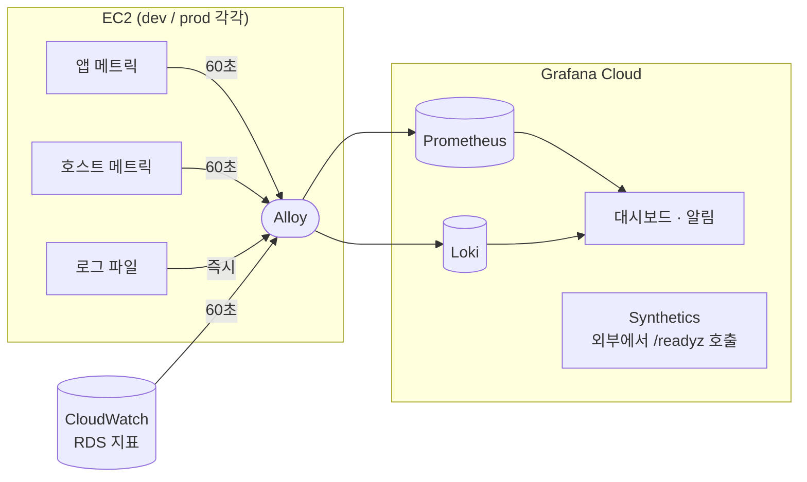

# 모니터링 구성

**모니터링과 알림이 어떻게 짜여 있는지 보는 문서다.** 쿼리나 임계값 같은 세부 설정은 Grafana Cloud 화면에 있고, 이 문서는 무엇을 왜 보는지와 어디를 고치면 되는지만 다룬다. 서버 배포는 [백엔드 배포 가이드](백엔드_배포_가이드.md)에서 다룬다.

---

## 1. 전체 구조



- **앱 지표**는 Spring Actuator가 만들고, **호스트 지표**는 Alloy가 직접 만든다. **로그**는 앱이 파일에 쓰고 Alloy가 읽는다. **RDS 지표**는 Alloy가 CloudWatch에서 읽어 온다. Alloy가 이것들을 모아 Grafana Cloud로 보낸다.
- 모든 지표와 로그에 `env` 라벨(`dev`/`prod`)이 붙는다. 값은 서버 `.env`의 `SPRING_PROFILES_ACTIVE`를 그대로 쓴다.
- 로그에는 `app` 라벨(`devica-app`)도 붙는다.
- Actuator는 호스트에 열지 않는 관리 포트 8081에 있다. 외부에 열린 헬스체크는 메인 포트의 `/readyz`뿐이며, ALB 헬스체크·배포 검증(`scripts/validate.sh`)·Synthetics가 이 경로를 쓴다.

---

## 2. 구성 요소와 위치

| 구성 요소            | 역할                       | 위치                                                               |
|------------------|--------------------------|------------------------------------------------------------------|
| Actuator 메트릭     | 앱 지표 노출, 응답시간 버킷 정의      | `application.yml`, `application-{dev,prod}.yml`                  |
| Alloy            | 수집·전송 에이전트               | `monitoring/config.alloy`, `docker-compose.server.yml`           |
| 접속 정보            | Grafana Cloud URL·계정·토큰  | 각 서버 `/opt/app/.env` (규격: `.env.server.example`)                 |
| CloudWatch 읽기 권한 | RDS 지표 조회                | 각 EC2의 인스턴스 역할. 키를 따로 두지 않는다                                     |
| 대시보드             | `Devica Overview`        | Grafana **Dashboards**                                           |
| 로그 파일            | 앱 ECS 로그                 | 각 서버 `/opt/app/logs/app` (규칙: [로깅 컨벤션](로깅_컨벤션.md))               |
| 알림 규칙            | 지표 기반 알림 9개, 로그 기반 알림 1개 | Grafana **Alerting → Alert rules** → `Devica` 폴더                 |
| 외부 헬스체크          | prod `/readyz` 호출과 실패 알림 | Grafana **Testing & synthetics → Synthetics** → `devica-readyz`  |
| 알림 수신처           | 이메일                      | Grafana **Alerting → Contact points**, **Notification policies** |

---

## 3. 수집하는 지표와 로그

서비스 특성에서 출발해 골랐다. 초기 읽기 전용 API의 앱·DB·호스트를 중심으로 구성했고,
쿠팡 가격 최신화에는 외부 API와 예약 작업 관찰이 추가로 필요하다.앱은 2GB 서버 한 대에서 실행한다. 
DB는 RDS라 이 서버의 지표에 잡히지 않아 CloudWatch에서 따로 가져온다([ADR 0038](adr/0038-DB-RDS-이전.md)).

| 구분        | 지표                                                            | 출처                 |
|-----------|---------------------------------------------------------------|--------------------|
| 요청 (RED)  | 경로별 요청 수, 상태코드(5xx·4xx), 응답시간 분포                              | Actuator           |
| 앱 내부      | 힙 사용량, GC 멈춤 시간, DB 커넥션 사용·대기                                 | Actuator           |
| 호스트 (USE) | 사용 가능한 메모리, swap in/out, 디스크 사용률, CPU                         | Alloy              |
| DB (RDS)  | 남은 저장 공간, 남은 메모리, 연결 수, CPU, CPU 크레딧, 읽기·쓰기 IOPS와 지연, 디스크 대기열 | CloudWatch → Alloy |
| 가용성       | 외부에서 본 `/readyz` 성공 여부                                        | Synthetics         |
| 수집 상태     | 보내지 못하고 버린 로그 수 (`loki_write_dropped_entries_total`)          | Alloy              |
| 로그        | 앱 ECS 로그(요청 로그, 예외 로그)                                        | 앱 → Alloy          |

- **응답시간은 버킷(100ms~5s)으로 수집한다.** 알림 기준은 버킷 경계 중에서 골라야 정확히 계산된다.
- **수집 간격은 60초다.** 요금이 series당 분당 데이터 1개 기준이다.
- **ALB 헬스체크(`/readyz`)는 대시보드·알림의 요청 집계에서 뺀다.** 30초마다 들어와 실제 사용량을 가린다.
- **Alloy가 자기 상태에 대해 내는 지표 중에서는 "전송하지 못하고 버린 로그 수"만 수집한다.** 메트릭은 정상인데 로그만 버려지는 경우를 알림으로 잡는 데 쓴다.
- **RDS 지표는 각 서버의 Alloy가 자기 환경의 RDS(`db-devica-<env>`)만 읽는다.** 인스턴스를 이름으로 지정하므로 RDS 이름을 바꾸면 `config.alloy`도 고친다.
- **RDS 지표는 몇 분 늦게 채워진다.** CloudWatch에 기록되기까지 몇 분 걸린다. 
- **RDS 지표가 없으면 0으로 채우지 않고 비워 둔다.** 비어 있으면 수집이 끊긴 것이므로 권한부터 확인한다([ADR 0047](adr/0047-RDS-지표-수집-방식.md)).
- **수집하지 않는 것**: 트레이스, RDS 로그, EC2의 CPU 크레딧.

---

## 4. 대시보드

위에서 아래로 **증상 → 원인** 순서로 배치했다. 상단 `Env` 드롭다운으로 dev와 prod를 전환한다.

| 행 | 보는 것 |
|---|---|
| Overview | 수집 상태, 최근 5xx, p95, 사용 가능한 메모리 |
| Requests (RED) | 경로별 요청 수·p95, 상태코드별 요청 수 |
| Host (USE) | 메모리, swap, 디스크, CPU |
| JVM / DB | 힙, GC, DB 커넥션 |
| Logs | 로그 수집 상태, 예외 종류별 추이, 4xx 원인별 개수, 1초 넘은 요청, ERROR 로그 원문, `trace.id` 로 요청 하나 찾기 |
| Offers | 판매처별 최근 가격 확인 성공/대상 수, 날짜별 실행 기록, 상품별 상세·실패/보류 로그 |

Logs 행은 메트릭이 답하지 못하는 "어떤 예외 때문인지, 어느 요청이었는지"를 본다. 상단 `Trace ID` 입력칸에 응답 헤더 `X-Trace-Id` 값을 넣으면 Trace Lookup 패널에 그 요청의 로그가 나온다.

Offers 행은 Grafana Cloud에서 직접 추가·관리한다. 저장소에는 설정 가이드와 쿼리만 유지한다.
성공은 가격 변경과 가격 동일 확인의 합계이며, 예를 들어 8건 변경·2건 동일·10건 보류이면 `10 / 20`이다.
기존 숨김 유지는 가격 확인 성공·보류와 별도로 집계한다. 모두 숨김 유지이면 실행 결과는 `SUCCESS`여도 카드는 `0 / 전체 대상`이며,
실행 기록의 숨김 유지 수와 함께 확인한다.
선택 기간의 최근 종료 실행 한 건을 표시하므로 여러 실행을 중복 합산하지 않는다.
일일 작업을 볼 때는 Last 2 days로 범위를 늘리고 한국 날짜를 확인할 때 Time zone을 Asia/Seoul로 둔다.
수동 설정과 쿼리는 [Offers 대시보드 설정](../monitoring/coupang-price-refresh/DASHBOARD.md)에 있다.

### 로그 조회

대시보드에 없는 조건은 Grafana **Explore**에서 Loki 데이터 소스를 골라 LogQL로 찾는다. 앱 로그는 ECS JSON이라 `| json`으로 필드를 꺼내 거른다. 필드 이름의 점(`.`)은 밑줄(`_`)로 바뀐다.

```
{env="prod", app="devica-app"} | json | trace_id="<X-Trace-Id 값>"
{env="prod", app="devica-app"} | json | log_level="ERROR"
{env="prod", app="devica-app"} | json | error_code="ANSWER_NOT_ALLOWED"
{env="prod", app="devica-app"} | json | http_route="/api/faqs/{slug}"
```

---

## 5. 알림

**prod에만 건다.** dev는 배포·재시작이 잦아 잡음만 생긴다.

| 알림                     | 잡는 상황                                                                     | 기준 (요약)                                              | 등급       |
|------------------------|---------------------------------------------------------------------------|------------------------------------------------------|----------|
| App Down               | 앱 수집 실패, 서버 전체 다운, **Alloy 다운**                                           | 3분 지속, 데이터 없음도 알림                                    | critical |
| 5xx Errors             | 서버 결함                                                                     | 5분간 3건 이상                                            | critical |
| High Latency           | 응답 지연                                                                     | 1초 초과 요청 10% 초과 (요청 10건 이상일 때만)                      | warning  |
| Low Memory             | 메모리 고갈                                                                    | 200MB 미만 5분 지속                                       | critical |
| Disk Almost Full       | 디스크 고갈                                                                    | 80% 초과 30분 지속                                        | warning  |
| RDS Storage Low        | DB 저장 공간 고갈                                                               | 남은 공간 40GiB(할당 200GiB의 20%) 미만 30분 지속                | warning  |
| RDS CPU Credits Low    | DB가 CPU를 기준 이상으로 계속 써서 크레딧이 바닥남. 이때부터 추가 요금이 붙음 (Unlimited 모드라 느려지지는 않음) | 크레딧 1 미만 30분 지속                                      | warning  |
| Synthetics (per-check) | 도메인·ALB·인증서 포함 사용자 경로 전체                                                  | 5분간 10회 중 6회 실패                                      | -        |
| RDS Metrics Missing    | RDS 지표만 끊김 (앱 지표는 정상이라 App Down 이 울리지 않는 경우)                              | 앱 지표는 들어오는데 RDS 지표가 없는 상태 30분 지속                     | warning  |
| Log Delivery Failed    | 로그만 버려짐 (메트릭은 정상이라 App Down 이 울리지 않는 경우)                                  | 버린 로그 수가 5분간 1건 이상 증가                                | warning  |
| Client-Server Mismatch | 배포 후 프론트엔드와 서버의 질문 데이터 불일치                                                | `ANSWER_NOT_ALLOWED`·`QUESTION_NOT_FOUND` 10분간 3건 이상 | warning  |

규칙에 공통으로 적용한 원칙이다.

- **울리면 바로 할 일이 있는 것만 건다.** 4xx는 봇 스캔과 섞여 알림에서 뺐고 대시보드에서만 본다.
- **트래픽이 적어 비율보다 건수로 건다.** 비율을 쓸 때는 최소 요청 수 조건을 붙인다.
- **HTTP 요청 처리 중의 예외(ERROR 로그)는 따로 알리지 않는다.** 곧 5xx라 5xx Errors 와 같은 사건으로 알림이 겹친다. 원인은 대시보드의 Logs 행에서 본다. 예약 작업의 실패는 별도로 관찰해야 한다.
- **"데이터 없음"은 App Down만 알림으로 본다.** 나머지는 정상으로 둬 같은 원인으로 알림이 겹치지 않게 한다.
- **데이터가 끊긴 뒤 "없음"으로 판정되기까지 최대 5분 걸린다.** 서버 다운은 Synthetics가 먼저 알린다.

---

### 가격 최신화 작업

가격 최신화는 HTTP 요청을 거치지 않으므로 실패해도 5xx가 발생하지 않는다.
기존 `5xx Errors` 알림으로는 이 작업의 실패를 감지할 수 없다.
앱이 로그에 남긴 것을 확인하는 일과, 그 로그를 조건으로 알림을 보내는 일은 별개다.

현재 코드에는 다음 로그가 있으며, 서버에서 실행하면 기존 앱 로그 파일 → Alloy → Loki 경로를 이용한다.
로컬 `coupangPriceRefresh`의 `build/reports/*.log`는 현재 Alloy 수집 대상이 아니므로 자동 전송되지 않는다.

- 실행 시작·종료: 판매처(`price_refresh.seller`), `price_refresh.run_id`, 전체 결과(`price_refresh.outcome`), 소요 시간(`event.duration`, ns)
- 상품별: 제품 코드(`product.code`), 오퍼 ID(`offer.id`), 결과·처리·API 실패 이유, 후보 ID·식별 실패 수, 전후 가격
- 확인 링크: `product.url`(Devica), `offer.url`(쿠팡). 숨김 제품은 쿠팡 링크로 확인
- 종료 집계: 가격 확인 성공(`price_refresh.success`)·숨김 유지(`price_refresh.hidden_unchanged`)·전체 대상(`price_refresh.total`), 가격 변경·가격 동일·보류·미시도·기존 숨김 복구 건수. 복구는 가격 확인 성공에 포함하며 숨김 유지는 별도다. 호환용 `price_refresh.hidden`은 항상 0
- 실행 예외: `FAILED` 결과와 예외. 프로세스가 강제 종료되면 종료 로그가 없을 수 있다.

Grafana Explore에서 Loki를 선택해 확인한다. 아래는 prod 기준이며 dev에서는 `env="dev"`로 바꾼다.

```logql
{env="prod", app="devica-app"} | json | log_logger="com.wrb.devica.product.infra.coupang.CoupangPriceRefreshJob"
```

`price_refresh_run_id`, `product_code`, `price_refresh_outcome` 필터를 추가하면 실행별·제품별 결과를 좁힐 수 있다.
이 ID들은 로그 필드로 사용하고 Prometheus 메트릭이나 Loki 스트림의 라벨로 추가하지 않는다.

**구현한 알림 조건과 실제 클라우드 등록을 구분한다.**

[가격 최신화 알림 설정](../monitoring/coupang-price-refresh/README.md)에 실행 요약과 종료 로그 누락 알림의 쿼리·설정 방법을 정리했다.
규칙은 Grafana Cloud에서 관리하며 저장소에 별도 설정 JSON을 두지 않는다.
실제 Grafana Cloud 등록·이메일 전달 확인은 별도 단계다.

- Grafana는 **15분마다 최근 1시간의 종료 로그**를 조회한다. 앱의 기본 실행 시각은 매일 04:00 KST로 유지한다.
- 실행 ID별로 가격 확인 성공·숨김 유지·전체·가격 변경·동일·보류·미시도·복구 건수를 모아 **실행당 요약 이메일 1회**를 목표로 설정한다.
  반복 간격은 24시간, 요약 전용 수신처의 해제 알림은 끄고, 기존 상품별 알림 규칙은 중지한다.
- `SUCCESS`, `PARTIAL`, `FAILED`, `NO_TARGETS`를 모두 요약에 포함한다. 예외로 집계가 없으면 실행 실패로 안내한다.
- 상품별 전후 가격·복구 여부·보류 원인·확인 링크는 Offers 대시보드와 같은 `run_id`의 로그에서 확인한다.
  후보가 있고 모든 ID를 읽었으나 기준 ID가 없으면, 판매 중인 상품은 `NO_MATCH`로 보류하고 기존 `HIDDEN` 상품은 `HIDDEN_UNCHANGED`로 정상 처리한다.
  둘 다 `action=NONE`이며 기존 상태·가격·확인 날짜를 유지한다. 빈 검색 결과, ID 해석·가격·API·DB 오류는 숨김 상품도 보류한다.
- 자동 갱신을 켠 환경에서 **15분마다 최근 26시간의 종료 로그**를 확인하고, 없으면 별도 누락 알림을 보낸다.
  첫 종료 로그를 확인한 뒤 활성화하고, 이후 기록이 돌아오면 해제 알림을 받을 수 있게 설정한다.

기존 이메일 주소를 사용하되 요약 전용 Contact point로 연결하고 Grafana에서 규칙을 등록·활성화해야 알림이 온다.
실행 요약은 종료 로그가 있어야 전달된다. 종료 로그가 없는 경우는 누락 규칙으로 확인한다.
가격 신선도는 아래 운영 기준으로 별도 검토한다.

| 확인할 상황 | 판정 기준 | 대응 |
|---|---|---|
| 정상 완료 | `SUCCESS`: 대상 모두 가격 확인 성공 또는 기존 숨김 유지 | 실행 요약, 대시보드에 기록 |
| 일부 보류 | `PARTIAL`: 정상 처리(가격 확인 성공 또는 숨김 유지)와 보류·미시도가 함께 있음 | 실행 요약에서 건수를 보고 원인 로그 확인 |
| 실행 실패 | `FAILED`: 대상이 있지만 가격 확인 성공·숨김 유지가 모두 0이거나 실행 예외 발생 | 실행 요약, 같은 실행 ID의 오류 확인 |
| 미실행·멈춤 | 최근 26시간 종료 로그 없음 | 누락 알림에서 스케줄·앱·로그 수집 상태 확인 |
| 대상 누락 | 기대한 대상이 있는데 `NO_TARGETS` | DB 상태·판매처·기준 ID 설정 확인 |
| 가격이 오래됨 | 판매 중인 상품의 `checkedAt`이 정한 허용 기간 초과 | 상품별 데이터 품질 확인 |

작업이 끝났어도 모두 `NO_MATCH`로 보류되면 `FAILED`다. 모두 `HIDDEN_UNCHANGED`이면 정상적인 숨김 유지로 `SUCCESS`이며,
가격 확인 성공은 0건이다. 모두 `UNCHANGED`이면 가격 변경 없이 가격 확인에 성공한 것이다.
가격 확인 성공 건수는 `updated + unchanged`로 보며 복구는 이미 포함된다. 전체 대상은
`success + hiddenUnchanged + deferred + notAttempted`이고, API HTTP 200만으로 성공을 판정하지 않는다.

현재 규모에서는 Loki 로그와 로그 기반 알림으로 시작할 수 있다.
누락 규칙은 Loki의 [`absent_over_time`](https://grafana.com/docs/loki/latest/query/metric_queries/)을 사용한다.
첫 종료 로그가 수집되기 전이나 의도적으로 작업을 끈 환경에서는 누락 규칙을 활성화하지 않는다.
로그 수집 장애와 작업 자체의 실패는 기존 App Down·Log Delivery Failed 알림과 함께 구분한다.

추후 Micrometer 지표를 추가하면 마지막 정상 실행 시각, 마지막 종료 시각, 실행 시간, 결과별 처리 건수를
기존 Actuator → Alloy → Prometheus 경로로 보낼 수 있다. 장시간 실행되는 앱 안의 스케줄 작업이므로
별도 Pushgateway가 필수는 아니다. 메모리의 마지막 성공 시각은 재시작하면 사라지므로 지속성도 함께 고려한다.
가격 신선도는 작업 성공 시각과 별도로 `checkedAt` 기준으로 확인해야 한다.
마지막 성공·종료 시각, 실행 시간, 처리량은 [Prometheus의 배치 작업 관찰 지침](https://prometheus.io/docs/practices/instrumentation/#batch-jobs)에서도 권장하는 지표다.

---

## 6. 바꾸고 싶을 때

| 하고 싶은 일             | 고칠 곳 | 배포 필요 |
|---------------------|---|---|
| 알림 추가, 기준값 변경       | Grafana Alert rules | 아니오 |
| 응답시간 기준을 버킷에 없는 값으로 | `application.yml`의 버킷 경계 | 예 |
| 앱에서 새 지표 만들기        | Micrometer로 코드에서 등록 → 자동 노출 | 예 |
| 호스트 지표 추가           | `monitoring/config.alloy`의 수집기 목록 | 예 |
| RDS 지표 추가           | `config.alloy`의 `prometheus.exporter.cloudwatch` 에 `metric` 블록 추가       | 예     |
| 수집할 로그 파일 추가        | `config.alloy`의 `local.file_match` 경로와 `docker-compose.server.yml`의 마운트 | 예 |
| 대시보드 수정             | Grafana에서 고친다. 이전 상태는 대시보드 설정의 **Versions**에서 되돌린다 | 아니오 |
| 수신처 변경·추가           | Grafana Contact points | 아니오 |

`config.alloy`는 배포할 때 서버로 복사되고 Alloy가 재시작되어 반영된다(`scripts/deploy.sh`).

---

## 7. 알아둘 제약

- **무료 플랜 한도**: 메트릭 series 1만 개, series당 분당 데이터 1개. 지표나 라벨을 늘리기 전에 현재 series 수를 확인한다.
- **CloudWatch 조회는 요청 수만큼 AWS 요금이 붙는다.** 지표 하나를 1분마다 읽으면 환경당 월 0.4달러 남짓이고, 지금 10개라 환경당 월 4달러 남짓이다. 지표를 늘릴 때 함께 따진다.
- **IAM은 팀 권한 밖이다.** RDS 지표는 EC2 인스턴스 역할에 이미 있는 CloudWatch 읽기 권한으로 가져온다([ADR 0047](adr/0047-RDS-지표-수집-방식.md)).
- **이메일은 Grafana 조직 멤버에게만 보낼 수 있다.** 받을 사람을 조직에 먼저 초대한다.
- **Slack은 보류했다.** 우테코 워크스페이스가 앱 설치 한도에 걸려 있다. 가능해지면 Contact point만 바꾸면 되고 규칙은 그대로 둔다.
