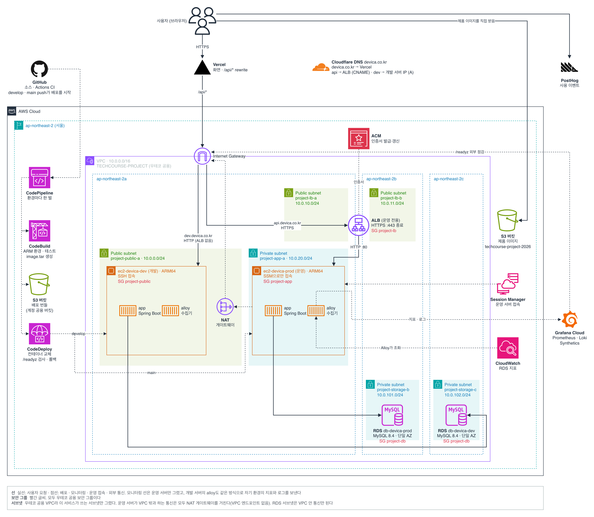

# 아키텍처

**서비스가 어떤 인프라 위에서 돌아가는지 한 장으로 보는 문서다.** 구성마다 왜 그렇게 정했는지는 아래 링크한 ADR에, 다루는 방법은 [백엔드 배포 가이드](백엔드_배포_가이드.md)와 [프론트엔드 배포 가이드](프론트엔드_배포_가이드.md)에 있다. 모니터링은 [모니터링 구성](모니터링_구성.md)에서 따로 다룬다.

---

## 1. 인프라 구성

원본은 [`images/인프라_구성.drawio`](images/인프라_구성.drawio)다. 구성이 바뀌면 원본을 고치고 PNG를 다시 내보낸다.

- **운영만 ALB를 거친다.** 운영은 `api.devica.co.kr` → ALB → private subnet의 EC2로 들어오고, 개발은 ALB 없이 public subnet의 EC2가 HTTP로 직접 받는다.
- **브라우저는 백엔드 주소를 모른다.** 화면은 `/api/...` 상대 경로로 호출하고, Vercel이 그 요청을 환경에 맞는 백엔드로 넘긴다.
- **제품 이미지는 백엔드를 거치지 않는다.** API는 S3 객체 URL만 돌려주고, 브라우저가 S3에서 직접 받는다.
- **서버는 들어오는 연결 없이 배포된다.** 각 EC2의 CodeDeploy 에이전트가 S3에서 배포 번들을 당겨 와 컨테이너를 교체한다. 그래서 운영 서버를 private subnet에 두어도 배포가 막히지 않는다.
- **환경마다 한 벌씩이다.** EC2, RDS, 파이프라인이 개발과 운영에 각각 있다. 두 서버는 같은 compose 파일로 `app`과 `alloy` 컨테이너를 띄운다.

### 왜 이렇게 구성했나

| 구성                                         | 이유                                                                                        | ADR                                                    |
|--------------------------------------------|-------------------------------------------------------------------------------------------|--------------------------------------------------------|
| 개발·운영 환경 분리                                | 운영 데이터는 되돌릴 수 없어, 변경을 먼저 확인할 서버와 DB가 따로 필요하다                                              | [0018](adr/0018-환경-분리.md)                              |
| 개발은 public, 운영은 private subnet             | 개발 서버는 자주 들여다보고 운영 서버는 사고 때만 접근해, 접근 편의와 보안을 환경마다 다르게 정했다                                 | [0017](adr/0017-서버-환경-분리.md)                           |
| 운영에 ALB + ACM                              | ACM이 인증서를 자동으로 갱신해, 갱신 실패를 서버의 수동 관리 대상으로 남기지 않는다                                         | [0016](adr/0016-HTTPS-처리-지점.md)                        |
| 프론트엔드는 Vercel                              | 저장소 연결만으로 빌드와 배포가 되고, 팀 AWS 계정의 권한 제약과 무관하다                                               | [0026](adr/0026-프론트엔드-배포처.md)                          |
| API는 Vercel rewrite로 연결                    | Vercel이 백엔드를 호출하므로 mixed content가 생기지 않고, 같은 오리진이라 CORS 설정이 필요 없다                         | [0027](adr/0027-API-요청-연결-방식.md)                       |
| CodePipeline · CodeBuild(ARM) · CodeDeploy | 팀 계정에서 액세스 키와 OIDC 역할을 만들 수 없어, AWS 안에서 서비스 역할로 도는 도구를 골랐다. EC2가 ARM64라 이미지도 ARM 환경에서 만든다 | [0014](adr/0014-CD-파이프라인.md)                           |
| 이미지를 레지스트리 없이 배포 번들로 전달                    | 팀 계정에 ECR 권한이 없고, CodeDeploy가 이미 S3를 거쳐 번들을 나른다                                           | [0015](adr/0015-배포-이미지-전달-방식.md)                       |
| DB는 RDS                                    | 백업과 시점 복구를 RDS에 맡기고, DB를 앱 서버의 생명 주기에서 떼어 낸다                                              | [0038](adr/0038-DB-RDS-이전.md)                          |
| 제품 이미지는 S3에서 직접 제공                         | 이미지 수가 적어, CloudFront는 필요해질 때 도입한다                                                        | [0032](adr/0032-제품-이미지-저장과-제공.md)                      |
| 로그·지표는 Alloy → Grafana Cloud               | 저장소 운영을 맡기고, 서버에는 수집기 하나만 둔다                                                              | [0034](adr/0034-로그-저장소.md), [0035](adr/0035-로그-수집기.md) |
| RDS 지표는 Alloy가 CloudWatch에서 조회             | IAM을 만들 수 없어, 인스턴스 역할에 이미 있는 CloudWatch 조회 권한을 쓴다                                         | [0047](adr/0047-RDS-지표-수집-방식.md)                       |

### 네트워크

VPC는 우테코 공용 계정의 것을 다른 팀과 함께 쓴다. 인터넷에서 요청을 받는 ALB와 개발 서버는 public subnet에, 운영 서버는 private subnet에, RDS는 VPC 밖과 통신하지 않는 서브넷에 있다. 운영 서버가 Grafana Cloud·S3·CodeDeploy와 통신할 때는 NAT 게이트웨이를 거친다. 도메인 `devica.co.kr`의 DNS는 Cloudflare가 맡는다.

서브넷·CIDR, DNS 레코드, 보안 그룹 규칙의 실제 값은 [백엔드 배포 가이드의 서버 구성](백엔드_배포_가이드.md#2-서버-구성)에 있다.
