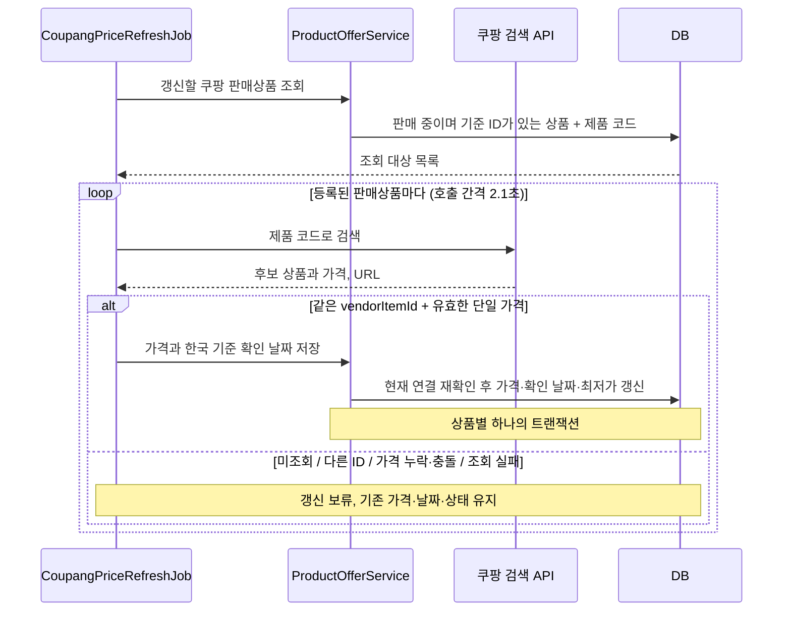

# 쿠팡 API 가격 조회 검증

검색 응답에서 기존 판매상품의 옵션 식별자와 가격을 확보할 수 있는지 확인하는 수동 도구다.
이 수동 명령은 Spring 서버와 DB를 기동하지 않는다. 가격 변경, 판매 상태 변경, 일일 스케줄은 실행하지 않는다.
기존 20개 상품의 기준 ID 준비는 [판매상품 ID 준비](쿠팡_판매상품_ID_준비.md)를 참고한다.
DB에 가격을 저장하는 일일 최신화는 아래의 **기존 판매상품의 일일 가격 갱신** 절에서 설명한다.

## 키 설정

### 로컬

저장소 루트에서 `coupang.local.env.example`을 `coupang.local.env`로 복사하고 두 값을 입력한다.
실제 키 파일은 `.gitignore`의 `*.env` 규칙으로 제외된다.

```dotenv
COUPANG_ACCESS_KEY=발급받은_ACCESS_KEY
COUPANG_SECRET_KEY=발급받은_SECRET_KEY
```

`KEY=value` 또는 `KEY="value"` 형식을 사용한다. 줄 끝 주석이나 셸 변수 치환은 지원하지 않는다.
이 도구는 두 키만 읽고 파일의 내용을 셸 명령으로 실행하지 않는다.
같은 이름의 환경변수가 설정되어 있으면 파일보다 우선한다. 키를 명령행 인자로 전달하지 않는다.

### 개발·운영 서버

각 서버의 `/opt/app/.env`에 같은 두 환경변수를 저장한다. 규격은 `.env.server.example`에 있다.
`docker-compose.server.yml`의 `env_file: .env`가 앱 컨테이너로 전달한다.
`.env`를 수정해도 이미 실행 중인 컨테이너의 환경변수는 바뀌지 않으므로 반영 시 컨테이너 재생성이 필요하다.
수동 명령은 Gradle 실행 환경에서 사용한다. 앱 컨테이너의 자동 갱신은 별도 설정으로 활성화한다.
자동 갱신을 배포하고 활성화한 뒤에는 매일 가격을 변경하기 위한 재배포가 필요하지 않다.

키는 자동 갱신을 끈 일반 앱 실행이나 모의 응답 테스트에 필요하지 않다.

## 실행

```bash
./gradlew coupangPriceProbe --args='--env-file=coupang.local.env'
```

환경변수로 이미 설정했다면 `--env-file`을 생략한다.

기본 대상은 `src/main/resources/coupang/price-probe-targets.json`의 4개다.
`V1.6__seed_prototype_products.sql`의 최초 등록값에서 가져왔으며, 현재 운영 DB를 읽은 값이 아니다.

| 제품 코드 | 선정 이유 |
|---|---|
| MDH74KH/A | 같은 페이지의 16GB·512GB 옵션 |
| MDHD4KH/A | 같은 페이지의 24GB·1TB 옵션 |
| Z1MM001CH | CPU·RAM·SSD 선택이 여러 개인 MacBook Pro |
| NT760VJT-A72A | 별도 페이지의 Windows 노트북 |

명령은 대상마다 키워드 검색을 1회 실행한다. 검색 결과는 최대 10개이며 전체 카탈로그가 아니다.
연속 요청 사이에 2.1초를 두고, 연결 5초·응답 10초의 타임아웃을 적용한다.
인증 실패 또는 HTTP 429가 발생하면 남은 대상은 `NOT_ATTEMPTED`로 기록하고 호출을 중단한다.
검증 단계에서는 자동 재시도하지 않는다. 같은 계정의 다른 실행과 겹치지 않게 사용한다.

## 보고서 확인

기본 출력은 Git에서 제외되는 `build/reports/coupang-price-probe-<UTC 실행시각>.json`이다.
검색 응답 중 상품 ID·상품명·가격·상품 URL만 기록하며 인증 헤더·키·응답 원문 전체는 기록하지 않는다.

| 필드 | 의미 |
|---|---|
| `target` | 검색어, 기대 사양과 기존 구매 URL |
| `observedAt` | 해당 요청을 처리한 UTC 시각. 가격 검증 완료 시각이 아님 |
| `outcome` | `RETRIEVED`, `NO_SEARCH_RESULTS`, `API_FAILURE`, `NOT_ATTEMPTED` |
| `failureReason` | 인증·호출 제한·연결·HTTP·응답 형식 오류 구분 |
| `candidates[].response` | API가 반환한 상품 ID, 상품명, 가격, URL |
| `candidates[].urlIdentifiers` | URL에서 추출한 `pageId`, `itemId`, `vendorItemId` |
| `candidates[].optionMatch` | 기존 URL과의 옵션 ID 비교 결과 |
| `candidates[].priceCheck` | 가격 누락·0 이하 여부, 또는 실제 가격 검증이 필요함을 표시 |

`MATCHED_OPTION_IDS`는 `itemId`와 `vendorItemId`가 모두 같다는 뜻이다.
API 응답의 `productId`와 URL의 `pageKey`는 별도로 기록하고 서로 같다고 가정하지 않는다.
페이지 ID만 같거나 상품명에 기대 사양이 있어도 옵션이 같다고 판단하지 않는다.
ID가 없으면 `INSUFFICIENT_IDENTIFIERS`, 다르면 `DIFFERENT_OPTION`, 해석할 수 없는 URL은 `INVALID_PRODUCT_URL`이다.
상품 URL을 추가 요청하거나 리다이렉트로 따라가지 않는다.

**옵션 ID 일치는 동일 사양·정확한 옵션 가격·일반 판매가 검증 완료를 뜻하지 않는다.**
보고서의 `verificationStatus`는 항상 `MANUAL_VERIFICATION_REQUIRED`이고, `databaseModified`는 `false`다.
가격이 양수여도 `REQUIRES_PRICE_VERIFICATION`으로 남긴다. 상품명에서 사양을 자동 확정하지 않는다.
검색 결과 누락을 품절로 취급하지 않는다.

정상 조회가 끝나면 종료 코드 0, 입력·설정·파일 오류는 1, API 실패가 있으면 보고서를 남기고 2로 종료한다.
종료 코드 0도 가격 자동 갱신이 가능하다는 판정은 아니다.

## 실제 응답 검증 절차

1. 후보의 `itemId`와 `vendorItemId`가 기존 구매 URL과 같은지 확인한다.
2. 실제 선택된 옵션이 기대 모델·CPU·RAM·SSD·OS와 맞는지 확인한다.
3. API의 `productPrice`가 그 옵션의 가격인지 확인한다.
4. [가격 기준](제품-가격-수집-대상.md)에 따라 카드·회원·별도 쿠폰 조건이 없는 일반 판매가인지 확인한다.
5. 확정 근거가 부족하면 갱신 가능으로 승인하지 않고, 확인 불가 이유를 기록한다.

실제 키로 실행한 보고서와 페이지 대조가 있어야 위 절차의 완료를 말할 수 있다.
모의 응답 테스트 통과는 실제 API의 옵션별 가격 재조회 지원을 증명하지 않는다.

검색어를 바꾸거나 대상을 최대 20개로 늘릴 때는 기본 JSON을 복사해 수정하고 별도 경로로 전달한다.
모델 코드를 포함한 검색이 결과를 반환하지 않을 경우 모델명·사양 중심의 검색어도 별도 실행으로 비교한다.

```bash
./gradlew coupangPriceProbe --args='--env-file=coupang.local.env --targets=build/coupang-targets.json'
```

필요하면 `--output=build/reports/coupang-probe.json`으로 출력 위치를 지정한다. 같은 경로는 덮어쓴다.

## 모의 응답 테스트

```bash
./gradlew test --tests 'com.wrb.devica.product.infra.coupang.*'
```

외부 API와 DB 없이 서명, 한글 검색어 인코딩, 응답 역직렬화, 오류 분류, 옵션 ID 충돌·누락 및 검증 보류를 확인한다.
공식 계약 확인 출처는 [파트너스 API 문서](https://partners.coupang.com/#help/open-api)의 검색 응답과 HMAC 가이드다.

## 기존 판매상품의 일일 가격 갱신

`CoupangPriceRefreshJob`은 DB에 등록된 쿠팡 판매상품을 검색하고, 저장된 `externalItemId`와
응답 URL의 `vendorItemId`가 같은 상품의 `productPrice`를 반영한다.
제품 코드로 검색한 최대 10개 후보 중에서 찾는 방식이다. `vendorItemId` 직접 조회 API가 아니므로
기존 20개 모두를 매일 재조회할 수 있다는 보장은 없다. 결과가 없으면 기존 정보를 유지한다.

### 구조와 저장 규칙



| 코드 | 역할 |
|---|---|
| `CoupangPriceRefreshConfig` | 활성화 설정, API 키, 타임아웃, 일일 실행 등록 |
| `CoupangPriceRefreshJob` | 순차 검색, vendorItemId 비교, 가격 검증, 실행 결과 로그 |
| `ProductOfferService` | 조회 대상 준비, 저장 직전 연결 재확인, 상품별 트랜잭션 |
| `ProductMinPriceRepository` | 기존 `product_min_price`에 판매 중인 오퍼의 최저가 재계산 |
| `PriceRefreshTarget` | 조회에 필요한 내부 ID·제품 코드·vendorItemId를 전달하는 값 |

- 대상은 판매처 이름이 `쿠팡`이고 상태가 `ON_SALE`이며 기준 ID가 있는 기존 상품이다.
- 자동 갱신은 **vendorItemId만** 비교한다. API의 `productId`, URL의 페이지 ID·`itemId`, 상품명은 일치 조건이 아니다.
  수동 probe의 `compareOption`은 여전히 두 옵션 ID를 비교하며, 자동 갱신과 목적이 다르다.
- 같은 ID의 가격이 양수여야 한다. 중복 후보의 가격이 모두 같으면 사용하고, 누락·0 이하·서로 다른 가격이면 보류한다.
- 가격이 달라지면 `price`와 `checkedAt`을 갱신한다. 가격이 같아도 마지막 확인 날짜인 `checkedAt`은 갱신한다.
- API 요청 중 판매처·상태·연결 ID가 바뀌었거나 더 최근 확인 날짜가 저장되었으면 보류한다.
- 가격 변경 시 상세 화면의 `product_offer`와 목록의 `product_min_price`를 같은 트랜잭션에서 갱신한다.
  다른 판매처의 판매 중인 오퍼가 더 저렴하면 그 가격이 목록 최저가로 유지된다.
- 외부 API 호출과 대기는 트랜잭션 밖에서 진행한다. 저장에 실패한 상품은 롤백하고 다음 상품을 처리한다.
- 인증 실패·HTTP 429는 남은 호출을 중단한다. 개별 연결·HTTP 오류는 해당 상품을 보류하고 다음 상품을 처리한다.
- 보류 시 가격·확인 날짜·판매 상태·구매 URL·기준 ID를 바꾸지 않는다. 상품 숨김·삭제·판매 재개 판정은 구현하지 않는다.

기준 ID에 연결된 최초 사양과 API 가격의 의미는 운영자가 확인한 것으로 전제한다.
이 작업은 상품명에서 사양이나 카드·회원·쿠폰 조건을 다시 검증하지 않는다.
사양 기반 신규 제품 검색·등록과 승인 테이블은 추가하지 않는다.

### 로컬에서 한 번 실행

저장소 루트의 기존 `coupang.local.env`를 그대로 사용한다. IDE에 키를 다시 입력하거나 실행 주기를 바꿀 필요가 없다.

```bash
docker compose up -d mysql
./gradlew coupangPriceRefresh
```

`CoupangPriceRefreshLocal`은 웹 서버와 예약 작업을 끈 상태에서 Spring의 DB 저장 서비스를 시작하고,
같은 `CoupangPriceRefreshJob`을 한 번 호출한 뒤 DB 연결과 HTTP 클라이언트를 닫고 종료한다.
이 명령은 조회 도구와 달리 **로컬 DB의 실제 가격을 변경한다**.
`local` 프로파일과 `localhost:3306/devica`의 `root/root` 접속을 사용하며, 포트만 `DB_PORT`로 바꿀 수 있다.
처음 실행하면 기존 앱과 마찬가지로 Flyway가 로컬 DB에 시드와 마이그레이션을 적용한다.

다른 위치의 키 파일을 사용하려면 경로만 전달한다.

```bash
./gradlew coupangPriceRefresh --args='--env-file=/로컬/경로/coupang.local.env'
```

파일에서 읽는 값은 `COUPANG_ACCESS_KEY`, `COUPANG_SECRET_KEY` 두 개뿐이다.
기존 probe와 동일하게 비어 있지 않은 환경변수가 있으면 파일 값보다 우선한다.
서버 프로파일이나 DB 주소를 명령 옵션으로 받지 않는다. 셸에 서버 설정이 있어도 로컬 연결 설정으로 실행한다.

결과는 콘솔과 `build/reports/coupang-price-refresh-<한국 실행시각>.log`에 남는다.
파일은 서버와 같은 ECS JSON 로그이며 Git에서 제외된다. 제품별 `product.code`, `offer.id`,
`price_refresh.result`와 실패 시 `error.code`를 확인한다. `price_refresh.run_id`로 한 실행을 묶는다.
가격·확인 날짜는 로컬 DB의 `product_offer`, 목록 최저가는 `product_min_price`에서 확인한다.

| 마지막 `price_refresh.outcome` | 의미 | 명령 종료 코드 |
|---|---|---|
| `SUCCESS` | 대상 모두 가격 확인·저장 성공. 가격이 동일한 경우 포함 | 0 |
| `PARTIAL` | 일부 확인 성공, 나머지는 보류 또는 미시도 | 2 |
| `FAILED` | 대상은 있으나 확인 성공한 상품이 없음 | 2 |
| `NO_TARGETS` | 갱신 대상이 없음 | 2 |
| 실행 예외 | 입력·기동·예상하지 못한 실행 실패 | 1 |

종료 코드 2이면 Gradle도 `BUILD FAILED`를 표시한다. 전부 성공한 것으로 오해하지 않기 위한 표시이며,
먼저 성공한 상품의 갱신을 되돌리지 않는다. 마지막 집계와 제품별 보류 이유를 확인한다.
시작 후 예외가 발생하면 `FAILED` 로그를 남기지만, 키 파일을 읽거나 앱을 기동하는 단계의 실패는
가격 작업 시작 전이므로 콘솔의 실행 오류를 확인한다.

### 실제 API 테스트 전 확인할 호출 제한

[쿠팡 파트너스 API 문서](https://partners.coupang.com/#help/open-api)의 **문서 → GET /products/search**에는
검색 API를 **1분당 최대 50회** 호출할 수 있다고 안내한다. 응답의 `limit=10`은 한 요청이 돌려주는
상품 후보의 최대 개수다. 후보 10개를 받더라도 API 요청은 1회로 계산한다.

로컬 1회 실행과 서버 일일 작업은 같은 `CoupangPriceRefreshJob`을 사용한다.
대상인 쿠팡 오퍼마다 제품 코드로 검색을 1회 호출한다. 시드의 20개가 모두 `ON_SALE`이고
`external_item_id`가 채워져 있으면 실행당 최대 20회이며, 대기 시간만 최소 19 × 2.1초 = 39.9초다.
실제 시간에는 API 응답과 DB 처리가 더해진다. 현재 DB에서 예상 호출 횟수는 실행 전에 조회할 수 있다.

```sql
SELECT COUNT(*) AS expected_api_calls
FROM product_offer
WHERE name = '쿠팡'
  AND status = 'ON_SALE'
  AND external_item_id IS NOT NULL
  AND TRIM(external_item_id) <> '';
```

| 상황 | 현재 동작과 테스트 시 주의점 |
|---|---|
| 같은 실행의 연속 호출 | 이전 상품 처리가 끝난 뒤 2.1초 기다리고 다음 요청을 보낸다. |
| 다른 실행과 겹침 | 로컬 명령, 수동 probe, dev/prod 서버 실행 사이에는 호출 간격을 공유하지 않는다. 같은 API 계정으로 동시에 실행하지 않는다. |
| HTTP 429 | `RATE_LIMITED`로 기록하고 남은 상품 호출을 중단한다. `Retry-After`에 따른 재개나 자동 재시도는 없다. |
| 인증 실패(401·403) | 남은 호출을 중단한다. 키와 계정 상태를 확인한다. |
| 개별 연결·HTTP 오류 | 해당 상품을 보류하고 다음 상품은 계속 조회한다. 연결 제한은 5초, 응답 대기는 10초다. |
| 바로 재실행 | 성공한 상품도 처음부터 다시 조회한다. 실패한 상품부터 이어서 실행하는 기능이나 실행 간 횟수 기록은 없다. |
| `NO_MATCH` | 검색 결과 최대 10개 안에서 같은 `vendorItemId`를 찾지 못했다는 뜻이다. 반복 호출 전에 검색 결과와 기준 ID를 확인한다. |

따라서 실제 키로 처음 확인할 때는 **한 번 실행하고 결과 로그를 읽은 뒤** 필요할 때 다시 실행한다.
429가 발생하면 즉시 반복 호출하지 않는다. 정확한 제한 해제 시각은 이 코드에서 알 수 없으므로
충분히 기다리고 다른 실행이 겹치지 않는지 확인한다. 로직만 검증할 때는 위의 모의 응답 테스트를 사용한다.

### 서버에서 일일 실행 활성화

기본값은 비활성화다. 실행할 서버의 `/opt/app/.env`에 API 키와 함께 설정한다.

```dotenv
COUPANG_PRICE_REFRESH_ENABLED=true
# 생략하면 한국 시간 매일 04:00
COUPANG_PRICE_REFRESH_CRON="0 0 4 * * *"
```

앱 이미지를 한 번 배포하고 환경변수가 반영되도록 컨테이너를 재생성하면 이후 매일 DB만 갱신한다.
기동 즉시 실행하거나 정지 중 놓친 작업을 보충하지 않고 다음 예약 시각에 실행한다.
키가 없는데 자동 갱신을 켜면 잘못된 설정으로 앱 기동이 실패한다.
`coupang.local.env`는 두 로컬 명령(`coupangPriceProbe`, `coupangPriceRefresh`)에서 읽는다.
일반 Spring 앱은 자동으로 읽지 않으며 서버에서는 컨테이너의 환경변수를 사용한다.

현재 환경별 앱 서버 한 대를 전제로 한다. 같은 DB에 연결된 여러 서버에서 동시에 활성화하지 않는다.
동일 API 계정을 쓰는 dev/prod는 실행 시각을 다르게 두고, 수동 probe도 겹쳐 실행하지 않는다.
여러 인스턴스로 확대할 때는 작업 실행자를 하나로 정하는 조정이 추가로 필요하다.

### 결과 확인과 테스트

상품별 `price_refresh.result` 로그에는 `UPDATED`, `UNCHANGED`, `SKIPPED`, `NO_MATCH`,
`INVALID_PRICE`, `CONFLICTING_PRICES`, `NOT_ATTEMPTED`가 남는다. API 실패는 `error.code`로 구분한다.
시작과 종료 로그를 남기고 마지막 로그에 전체 결과, 변경·가격 동일·보류·미시도 건수, 소요 시간을 집계한다.
가격이 바뀌지 않아도 확인에 성공했으면 성공으로 집계한다. 키와 인증 헤더, 전체 응답은 기록하지 않는다.
로그 외에 이력 테이블이나 추가 JSON 보고서는 만들지 않는다.
서버에서의 조회와 알림 기준은 [모니터링 구성](모니터링_구성.md#가격-최신화-작업)을 참고한다.

```bash
./gradlew test --tests 'com.wrb.devica.product.*' --tests 'com.wrb.devica.common.FlywayMigrationTest' bootJar
```

API는 모의 응답으로 검증하고 DB 저장은 테스트 전용 MySQL에서 검증한다.
실제 API 응답과 20개 상품의 가격을 대조하는 작업, dev/prod의 활성화·실행은 별도 운영 확인이다.
