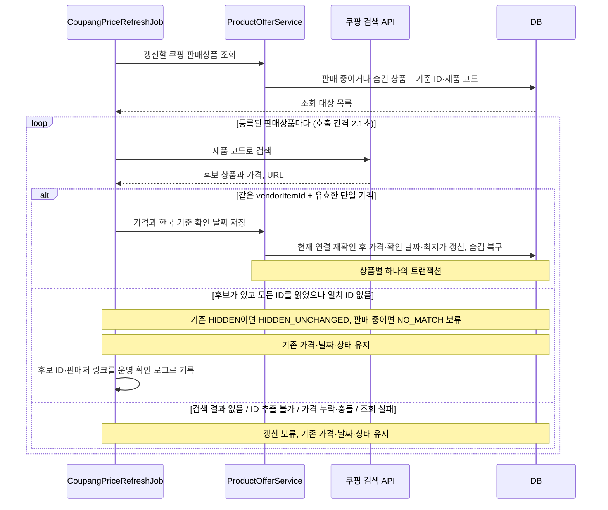

# 쿠팡 가격 최신화 가이드

기존 쿠팡 판매상품의 기준 ID를 대조하고 가격·확인 날짜를 갱신하는 방법을 다룬다.
실행 전 저장된 상품 연결을 점검하려면 [기준 ID 확인](#기준-id-확인)을 참고한다.

| 실행 방식 | 목적 | DB 변경 |
|---|---|---|
| `coupangPriceRefresh` | 로컬 DB의 기존 판매상품 가격을 한 번 최신화 | 가격·확인 날짜, 기존 숨김 상품의 복구 상태 변경 |
| 서버 예약 작업 | 활성화한 서버에서 매일 최신화. 기본 04:00 KST | 로컬 최신화와 같은 저장 규칙 적용 |

- [동작 원칙](#동작-원칙): 가격 기준, 조회 대상, ID·가격 비교, 저장 규칙과 호출 제한
- [로컬 실행](#로컬-실행): 키 설정, 일회성 최신화, 테스트
- [서버 운영](#서버-운영): 환경변수, 예약 실행, 모니터링
- [문제 확인](#문제-확인): 기준 ID 확인, 실행 결과·종료 코드, 상품별 원인

## 동작 원칙

`CoupangPriceRefreshJob`은 DB에 등록된 쿠팡 판매상품을 검색하고, 저장된 `externalItemId`와
응답 URL의 `vendorItemId`가 같은 상품의 `productPrice`를 반영한다.
제품 코드로 검색한 최대 10개 후보 중에서 찾는 방식이다. `vendorItemId` 직접 조회 API가 아니므로
등록된 상품을 모두 매일 재조회할 수 있다는 보장은 없다. 검색 결과 없음과 식별 실패는 보류하며,
후보가 있고 모든 후보의 ID를 확인했지만 저장된 ID가 없으면 판매 중인 상품은 `NO_MATCH`로 보류하고,
기존 `HIDDEN` 상품은 `HIDDEN_UNCHANGED`로 숨김을 유지한다. 둘 다 기존 상태·가격·확인 날짜를 유지한다.
판매 중인 상품의 `NO_MATCH`는 판매처 링크로 확인을 요청한다.

### 가격 기준

`price`는 **저장된 구매 URL이 가리키는 정확한 옵션 1개를 누구나 별도 자격이나 쿠폰 발급 없이
구매할 때의 일반 판매가**다. 상세 화면의 **일반 판매가** 표시와 같은 뜻으로 사용한다.
누구에게나 즉시 적용되는 공개 할인은 반영하고, 특정 카드·회원 등급·별도 발급 쿠폰 조건부 가격은 제외한다.
배송비는 상품 가격과 구분하며, 확인하지 못한 배송비를 0원으로 가정하지 않는다.

같은 옵션에 정가 240만 원, 일반 판매가 220만 원, 카드 결제 시 210만 원이 보이면 `price`는 220만 원이다.
페이지에서 일반 판매가를 명확히 찾지 못하면 임의로 정가나 카드 가격을 대입하지 않는다.
API의 `productPrice`가 이 기준에 맞는지는 [최초 연결 시 검증](#최초-연결-시-실제-응답-검증)에서 확인한다.

수집기의 가격 선택 규칙, 백엔드 입력 검증, 화면의 가격 문구에 같은 기준을 사용한다.
배송비까지 합친 최종 결제 금액을 비교하려면 데이터 구조와 화면 문구도 함께 설계해야 한다.

### 처리 흐름과 저장 규칙



| 코드 | 역할 |
|---|---|
| `CoupangPriceRefreshConfig` | 예약 실행 또는 run-once에 사용할 공통 API 클라이언트·가격 작업 빈 구성 |
| `CoupangPriceRefreshJob` | 순차 검색, vendorItemId 비교, 가격 검증, 실행 결과 로그 |
| `ProductOfferService` | 조회 대상 준비, 저장 직전 연결 재확인, 상품별 트랜잭션 |
| `ProductMinPriceRepository` | 기존 `product_min_price`에 판매 중인 오퍼의 최저가 재계산 |
| `PriceRefreshTarget` | 조회에 필요한 내부 ID·제품 코드·vendorItemId를 전달하는 값 |

- 대상은 판매처 이름이 `쿠팡`이고 상태가 `ON_SALE` 또는 `HIDDEN`이며 기준 ID가 있는 기존 상품이다.
  숨긴 상품도 매일 재확인하며 동일 ID와 유효한 가격이 발견되면 `ON_SALE`로 복구한다.
- 자동 갱신은 **vendorItemId만** 비교한다. API의 `productId`, URL의 페이지 ID·`itemId`, 상품명은 일치 조건이 아니다.
- 같은 ID의 가격이 양수여야 한다. 중복 후보의 가격이 모두 같으면 사용하고, 누락·0 이하·서로 다른 가격이면 보류한다.
- 가격이 달라지면 `price`와 `checkedAt`을 갱신한다. 가격이 같아도 마지막 확인 날짜인 `checkedAt`은 갱신한다.
- API 요청 중 판매처·상태·연결 ID·구매 URL·가격이 바뀌었거나 더 최근 확인 날짜가 저장되었으면 보류한다.
- 가격 변경 시 상세 화면의 `product_offer`와 목록의 `product_min_price`를 같은 트랜잭션에서 갱신한다.
  다른 판매처의 판매 중인 오퍼가 더 저렴하면 그 가격이 목록 최저가로 유지된다.
- 외부 API 호출과 대기는 트랜잭션 밖에서 진행한다. `DataAccessException`으로 처리한 저장 실패는 해당 상품을 롤백하고 다음 상품을 처리한다.
- 상품 저장의 트랜잭션을 시작하지 못하면(`CannotCreateTransactionException`) 현재 상품은 `DB_FAILURE`로 보류하고
  남은 API 호출을 중단한다. 남은 상품은 `NOT_ATTEMPTED`로 기록하고 이미 성공한 건수를 포함해 종료 집계를 남긴다.
- HTTP 401·403 인증 실패와 HTTP 429는 남은 호출을 중단한다. 개별 연결·HTTP 오류는 해당 상품을 보류하고 다음 상품을 처리한다.
- HTTP 성공 응답에 `rCode`가 있고 값이 `"0"`이 아니면 `API_REJECTED`로 해당 상품을 보류하고 다음 상품을 계속 처리한다.
  코드별 의미가 확정되지 않았으므로 `rCode="403"`·`"429"`도 HTTP 상태나 한도 초과로 단정하지 않는다.
  정상 상품까지 중단하지 않고 상품별 결과를 확인하려는 정책이며, 실제 HTTP 401·403·429의 중단 규칙과 구분한다.
- 후보가 있고 모든 ID를 읽었으나 일치 ID가 없을 때, 기존 `HIDDEN` 상품은 `HIDDEN_UNCHANGED`로 정상 처리한다.
  `action=NONE`이며 가격·확인 날짜·구매 URL·기준 ID·숨김 상태를 모두 유지한다. 가격 확인 성공이나 보류에는 포함하지 않는다.
  빈 검색 결과, ID 해석 실패, 유효하지 않은 가격, API·DB 오류는 숨김 상품이어도 기존대로 보류한다.
- 판매 중인 상품의 `NO_MATCH`도 가격·확인 날짜·구매 URL·기준 ID·노출 상태를 모두 유지한다.
  최대 10개인 검색 후보에 없다는 사실만으로 판매 종료나 실제 상품 변경을 판정할 수 없다.
  후보 ID와 판매처·Devica 링크를 로그에 남기고 운영자가 직접 확인한다.
  검색 누락으로 자동 숨김하지 않는다. 숨김 정책을 추가하려면 해당 옵션의 판매 상태를 직접 확인할 근거가 필요하다.
  이전 버전에서 숨긴 상품은 동일 ID·유효한 가격을 확인했을 때만 복구하며 최저가도 같은 트랜잭션에서 재계산한다.
- 숨긴 오퍼가 있고 판매 중인 다른 오퍼가 없으면 목록·추천순·가격순·브랜드 필터에서 제외한다.
  상세 API는 제품 정보를 200으로 반환하고 판매처 목록은 빈 배열로 제공한다. 화면에는 “판매 중인 곳이 없습니다.”를 표시한다.
  실제로 없는 제품은 계속 404다. 다른 판매처가 `ON_SALE`이면 목록에서도 제품을 노출하고 상세에는 판매 중인 판매처만 제공한다.
  기존의 오퍼 미등록·품절 상품 노출 규칙은 유지한다.
- 별도 테이블이나 컬럼은 추가하지 않는다. 기존 VARCHAR 상태에 `HIDDEN` 값을 사용한다.
  숨김 값을 기록한 DB에는 이 상태를 모르는 이전 앱 버전을 바로 실행하지 않는다.

기준 ID에 연결된 최초 사양과 API 가격의 의미는 운영자가 확인한 것으로 전제한다.
이 작업은 상품명에서 사양이나 카드·회원·쿠폰 조건을 다시 검증하지 않는다.
사양 기반 신규 제품 검색·등록과 승인 테이블은 추가하지 않는다.

### 최초 연결 시 실제 응답 검증

1. 후보의 `itemId`와 `vendorItemId`가 기존 구매 URL과 같은지 확인한다.
2. 실제 선택된 옵션이 기대 모델·CPU·RAM·SSD·OS와 맞는지 확인한다.
3. API의 `productPrice`가 그 옵션의 가격인지 확인한다.
4. [가격 기준](#가격-기준)에 따라 카드·회원·별도 쿠폰 조건이 없는 일반 판매가인지 확인한다.
5. 확정 근거가 부족하면 갱신 가능으로 승인하지 않고, 확인 불가 이유를 기록한다.

확인 시점의 실제 API 응답과 상품 페이지를 대조한 근거가 있어야 위 절차의 완료를 말할 수 있다.
모의 응답 테스트 통과는 실제 API의 옵션별 가격 재조회 지원을 증명하지 않는다.
과거 응답을 확인했더라도 이후 검색에서 같은 옵션과 가격을 다시 얻을 수 있다는 보장은 없다.

### 호출 제한과 실행 간격

[쿠팡 파트너스 API 문서](https://partners.coupang.com/#help/open-api)의 **문서 → GET /products/search**에는
검색 API를 **1분당 최대 50회** 호출할 수 있다고 안내한다. 응답의 `limit=10`은 한 요청이 돌려주는
상품 후보의 최대 개수다. 후보 10개를 받더라도 API 요청은 1회로 계산한다.

로컬 1회 실행과 서버 일일 작업은 같은 `CoupangPriceRefreshJob`을 사용한다.
대상인 쿠팡 오퍼마다 제품 코드로 검색을 1회 호출한다. 예를 들어 조회 대상이 20개라면
실행당 최대 20회이며, 대기 시간만 최소 19 × 2.1초 = 39.9초다.
실제 시간에는 API 응답과 DB 처리가 더해진다. 현재 DB에서 예상 호출 횟수는 실행 전에 조회할 수 있다.

```sql
SELECT COUNT(*) AS expected_api_calls
FROM product_offer
WHERE name = '쿠팡'
  AND status IN ('ON_SALE', 'HIDDEN')
  AND external_item_id IS NOT NULL
  AND TRIM(external_item_id) <> '';
```

| 상황 | 현재 동작과 테스트 시 주의점 |
|---|---|
| 같은 실행의 연속 호출 | 이전 상품 처리가 끝난 뒤 2.1초 기다리고 다음 요청을 보낸다. |
| 다른 실행과 겹침 | 로컬 명령과 dev/prod 서버 실행 사이에는 호출 간격을 공유하지 않는다. 같은 API 계정으로 동시에 실행하지 않는다. |
| HTTP 429 | `RATE_LIMITED`로 기록하고 남은 상품 호출을 중단한다. `Retry-After`에 따른 재개나 자동 재시도는 없다. |
| 인증 실패(401·403) | 남은 호출을 중단한다. 키와 계정 상태를 확인한다. |
| 개별 연결·HTTP 오류 | 해당 상품을 보류하고 다음 상품은 계속 조회한다. 연결 제한은 5초, 응답 대기는 10초다. |
| 바로 재실행 | 성공한 상품도 처음부터 다시 조회한다. 실패한 상품부터 이어서 실행하는 기능이나 실행 간 횟수 기록은 없다. |
| `NO_MATCH` | 판매 중인 상품에서 최대 10개인 후보의 ID를 모두 읽었지만 저장 ID가 없음. 노출·가격·날짜를 유지하고 운영 확인을 요청한다. |
| `HIDDEN_UNCHANGED` | 기존 `HIDDEN` 상품에서 후보가 있고 모든 ID를 읽었으나 저장 ID가 없음. 가격·날짜를 바꾸지 않고 숨김 유지로 정상 처리한다. |

따라서 실제 키로 처음 확인할 때는 **한 번 실행하고 결과 로그를 읽은 뒤** 필요할 때 다시 실행한다.
429가 발생하면 즉시 반복 호출하지 않는다. 정확한 제한 해제 시각은 이 코드에서 알 수 없으므로
충분히 기다리고 다른 실행이 겹치지 않는지 확인한다. 로직만 검증할 때는 [모의 응답 테스트](#모의-응답과-db-테스트)를 사용한다.

## 로컬 실행

### API 키 설정

저장소 루트에서 `coupang.local.env.example`을 `coupang.local.env`로 복사하고 두 값을 입력한다.
실제 키 파일은 `.gitignore`의 `*.env` 규칙으로 제외된다.

```properties
COUPANG_ACCESS_KEY=발급받은_ACCESS_KEY
COUPANG_SECRET_KEY=발급받은_SECRET_KEY
```

이 파일은 Spring의 properties 로더로 읽는다. 따옴표 없는 `KEY=value` 형식을 사용하고 `export`를 붙이지 않는다.
기존 파일에 값을 감싼 따옴표가 있다면 실행 전에 형식을 확인한다. 따옴표와 줄 끝 주석은 값의 일부로 읽힐 수 있다.
키 파일에는 위 두 API 키만 작성한다. 파일 전체를 설정으로 가져오지만 셸 명령으로 실행하지는 않는다.
같은 이름의 셸 환경변수가 파일보다 우선한다. 키를 명령행 인자로 전달하지 않는다.
`application.yml`이 기존 두 입력을 `coupang.access-key`, `coupang.secret-key`로 연결하고 Java 설정은 이 속성명을 읽는다.
서버 환경변수와 로컬 키 파일의 이름·형식은 동일하게 유지한다.

키는 자동 갱신을 끈 일반 앱 실행이나 모의 응답 테스트에 필요하지 않다.

### 가격 최신화 한 번 실행

저장소 루트에서 실행한다. 키 파일을 쓰면 위의 properties 형식을 먼저 확인한다.

```bash
docker compose up -d mysql
./gradlew coupangPriceRefresh
```

Gradle 태스크는 `DevicaApplication`을 `local` 프로파일, 웹 실행 모드 `none`,
`coupang.price-refresh.run-once=true`, `coupang.price-refresh.cron=-`로 시작한다.
run-once 전용 `ApplicationRunner`가 공통 빈인 `CoupangPriceRefreshJob`을 한 번 실행하고,
결과에 따른 종료 코드와 함께 앱을 종료한다. 웹 서버와 예약 작업은 시작하지 않으며 DB 연결과 HTTP 클라이언트도 정리한다.
이 명령은 **로컬 DB의 가격·확인 날짜와 기존 숨김 상품의 복구 상태를 변경한다**.
기본 연결은 `localhost:3306/devica`이며, DB 계정은 `application-local.yml` 설정을 사용한다.
포트는 `DB_PORT`로 바꿀 수 있다. 처음 실행하면 기존 앱과 마찬가지로 Flyway가 로컬 DB에 시드와 마이그레이션을 적용한다.

기본 키 파일 설정은 `optional:file:./coupang.local.env[.properties]`다.
파일이 없어도 셸 환경변수로 두 API 키를 제공할 수 있다. 다른 위치의 파일은 다음 옵션 하나로 지정한다.

```bash
./gradlew coupangPriceRefresh --args='--spring.config.import=file:/로컬/경로/coupang.local.env[.properties]'
```

`[.properties]`는 `.env` 파일을 properties 형식으로 읽도록 하는 힌트다.
사용자 실행 옵션은 `--spring.config.import=경로[.properties]` 하나만 허용한다.
서버 프로파일이나 DB 주소 등 다른 실행 옵션은 받지 않는다.

원격 DB 주소, 추가 프로파일, Hikari·Flyway의 별도 연결 설정으로 로컬 범위를 벗어나려는 설정은
DB 빈을 만들기 전에 거부한다. 잘못된 서버 설정을 로컬 값으로 덮어써서 계속 실행하지 않는다.
웹 실행 모드와 예약 작업 차단 조건도 DB 연결 전에 확인한다. 설정 오류가 있으면 해당 환경변수·설정 출처를 정리한 뒤 실행한다.

실행 로그와 DB 확인 위치, 종료 코드의 의미는 [가격 갱신 실행 결과](#가격-갱신-실행-결과)를 참고한다.

### 모의 응답과 DB 테스트

```bash
./gradlew test --tests 'com.wrb.devica.product.infra.coupang.*'
```

외부 API와 DB 없이 서명, 한글 검색어 인코딩, 응답 역직렬화, 오류 분류, 옵션 ID 충돌·누락 및 검증 보류를 확인한다.
공식 계약 확인 출처는 [파트너스 API 문서](https://partners.coupang.com/#help/open-api)의 검색 응답과 HMAC 가이드다.

```bash
./gradlew test --tests 'com.wrb.devica.product.*' --tests 'com.wrb.devica.common.FlywayMigrationTest' bootJar
```

API는 모의 응답으로 검증하고 DB 저장은 테스트 전용 MySQL에서 검증한다.
실제 API 응답과 등록된 상품의 가격을 대조하는 작업, dev/prod의 활성화·실행은 별도 운영 확인이다.

초기 데이터의 기준 ID와 URL 일치 여부, 중복·누락 및 URL 파싱은 다음 테스트로 확인한다.
이 테스트는 현재 판매 상태나 API 가격의 정확성을 검증하지 않는다.

```bash
./gradlew test --tests 'com.wrb.devica.common.FlywayMigrationTest' \
  --tests 'com.wrb.devica.product.infra.coupang.CoupangProductUrlTest'
```

## 서버 운영

### 서버 키 설정

각 서버의 `/opt/app/.env`에 같은 두 환경변수를 저장한다. 규격은 `.env.server.example`에 있다.
`docker-compose.server.yml`의 `env_file: .env`가 앱 컨테이너로 전달한다.
`.env`를 수정해도 이미 실행 중인 컨테이너의 환경변수는 바뀌지 않으므로 반영 시 컨테이너 재생성이 필요하다.
수동 명령은 Gradle 실행 환경에서 사용한다. 앱 컨테이너의 자동 갱신은 별도 설정으로 활성화한다.
자동 갱신을 배포하고 활성화한 뒤에는 매일 가격을 변경하기 위한 재배포가 필요하지 않다.

### 일일 실행 활성화

기본값은 비활성화다. 실행할 서버의 `/opt/app/.env`에 API 키와 함께 설정한다.

```dotenv
COUPANG_PRICE_REFRESH_ENABLED=true
# 생략하면 한국 시간 매일 04:00
COUPANG_PRICE_REFRESH_CRON="0 0 4 * * *"
```

앱 이미지를 한 번 배포하고 환경변수가 반영되도록 컨테이너를 재생성하면 이후 매일 DB만 갱신한다.
기동 즉시 실행하거나 정지 중 놓친 작업을 보충하지 않고 다음 예약 시각에 실행한다.
키가 없는데 자동 갱신을 켜면 잘못된 설정으로 앱 기동이 실패한다.
`coupang.local.env`는 `coupangPriceRefresh`가 `spring.config.import`로 가져온다.
일반 서버 실행은 이 파일을 자동으로 읽지 않고 컨테이너의 환경변수를 사용한다.
서버의 run-once 기본값은 `false`이며, 일반 앱 기동으로 일회성 작업을 실행하거나 앱을 종료하지 않는다.

현재 환경별 앱 서버 한 대를 전제로 한다. 같은 DB에 연결된 여러 서버에서 동시에 활성화하지 않는다.
동일 API 계정을 쓰는 dev/prod는 실행 시각을 다르게 두고, 로컬 일회성 작업도 겹쳐 실행하지 않는다.
여러 인스턴스로 확대할 때는 작업 실행자를 하나로 정하는 조정이 추가로 필요하다.

### 제품 링크와 모니터링

서버 제품 링크는 `DEVICA_PUBLIC_BASE_URL`로 설정한다(prod 기본 `https://devica.co.kr`, dev는
`https://2026-devica.vercel.app`). 로컬 명령은 셸 환경변수가 없으면 `http://localhost:5173`을 사용한다.

앱에는 실행·상품별 결과를 남기는 로그가 구현되어 있다. 서버 로그는 기존 앱 로그 파일 → Alloy → Loki 경로를 사용한다.
로컬 `build/reports/*.log`는 서버 Alloy의 수집 대상이 아니므로 Cloud에 자동 전송되지 않는다.
대시보드·알림 규칙·수신처의 실제 설정은 Grafana Cloud에서 관리한다. 아래는 운영 시 확인할 기준이며,
문서 변경이나 앱 배포만으로 패널·이메일 알림이 생기지는 않는다. 실제 Cloud 조회·이메일 전달 검증은 별도로 필요하다.

### 로그와 대시보드 확인

Grafana **Explore**에서 앱 로그가 쌓이는 Loki를 선택한다. 일일 작업은 우선 **Last 2 days**로 보고,
한국 날짜를 확인할 때 시간대는 **Asia/Seoul**로 둔다. 아래는 prod 예시이며 dev에서는 `env`만 바꾼다.

```logql
{env="prod", app="devica-app"}
| json
| log_logger="com.wrb.devica.product.infra.coupang.CoupangPriceRefreshJob"
| price_refresh_seller="COUPANG"
| __error__=""
```

`| json`으로 꺼낸 필드는 점(`.`)이 밑줄(`_`)로 바뀐다. 위 쿼리 끝에 필요한 필터를 추가한다.

| 확인할 내용 | 추가 필터 |
|---|---|
| 실행 종료·실패 | `\| price_refresh_outcome!=""` |
| 특정 실행의 시작·상품 결과·종료 | `\| price_refresh_run_id="실행_ID"` |
| 상품별 결과 | `\| price_refresh_result!=""` |
| 보류·미시도만 | 상품별 필터 뒤에 `\| price_refresh_result!~"UPDATED\|UNCHANGED\|RESTORED\|HIDDEN_UNCHANGED"` |

`NO_MATCH` 같은 보류는 INFO 로그이므로 ERROR만 검색하면 놓친다. 원인과 링크는
[상품별 결과와 확인 링크](#상품별-결과와-확인-링크)에서 확인하고, 필요하면 `offer_id`·`product_code`로 좁힌다.
실행·상품 ID는 조회 필드로 사용하며 Loki 스트림 라벨이나 Prometheus 메트릭 라벨에 추가하지 않는다.

Offers 대시보드를 구성한다면 최근 실행의 가격 확인 성공/전체, 실행 기록, 상품별 결과·보류 로그를 본다.
성공/전체 카드는 선택 기간의 **가장 최근 종료 로그 한 건**을 사용한다(Range·Backward·최대 1줄). 여러 실행의 건수를 합산하지 않는다.
집계 의미는 [가격 갱신 실행 결과](#가격-갱신-실행-결과)를 따른다. 실행 중에는 이전 종료 기록이 보일 수 있으므로 시각도 확인한다.
집계가 없는 `FAILED`는 0건이 아니라 집계 실패이며, 해당 필드가 없는 과거 로그도 0으로 추정하지 않는다.
선택 기간에 종료 로그가 없으면 데이터 없음으로 보고, 실행 누락·조회 기간·로그 수집 문제를 구분한다.
패널 새로고침은 Loki만 조회하며 쿠팡 API를 호출하지 않는다.

### 알림 운영 기준

가격 최신화는 HTTP 요청 밖에서 실행되므로 기존 5xx 알림만으로 실패를 감지할 수 없다.
알림을 활성화할 환경은 [공통 모니터링 정책](모니터링_구성.md#5-알림)을 따른다.
가격 변경·복구·숨김 유지·보류 상품은 개별 이메일 대신 같은 실행 ID의 로그에서 확인한다.
알림을 구성할 때의 기준은 다음과 같다. 평가 주기는 모두 **15분**이며 앱 실행 주기와는 별개다.

| 알림 | 조회·판정 기준 | 확인할 내용 |
|---|---|---|
| 실행 요약 | 최근 **1시간**의 종료 로그를 실행 ID별로 집계해 건수가 0보다 크면 알림 | `SUCCESS`·`PARTIAL`·`FAILED`·`NO_TARGETS` 모두 포함. 결과·집계·실행 ID로 상세 로그 확인 |
| 종료 로그 누락 | 최근 **26시간**의 종료 로그에 `absent_over_time`을 적용해 값이 1이면 알림 | 작업 활성화·앱 상태·지연·Alloy/Loki 수집 상태 확인. `FAILED`도 종료 기록에 포함 |

- 알림 쿼리는 Instant와 Threshold `> 0`을 사용한다. 요약 쿼리의 실행 ID 라벨을 보존하고, 이를 없애는 Classic condition은 사용하지 않는다.
- 요약은 실행 ID별로 묶고 반복 간격을 조회 범위보다 긴 **24시간**으로 둔다. 요약 전용 수신처의 해제 알림은 끈다.
  조회 범위에서 빠진 것을 복구로 알리지 않기 위해서다. 실행당 1회를 목표로 하며 장애·규칙 재생성까지 포함한 정확히 한 번의 전달 보장은 아니다.
- 누락은 환경별로 묶고 반복 간격을 **24시간**으로 둔다. 요약과 다른 수신처 설정을 사용해 종료 로그가 돌아오면 해제 알림을 받는다.
  요약·누락 라우팅을 분리하고, 기존 상품별 알림이 있다면 중복 발송되지 않도록 정리한다.
- 두 규칙 모두 **No data는 Normal/OK**, **조회 오류는 Error**로 구분한다. 특히 누락 쿼리는 종료 로그가 있으면 빈 결과,
  없으면 1을 반환하므로 No data 자체를 실패로 설정하지 않는다.
- 누락 규칙은 자동 갱신을 켠 환경에서 첫 종료 로그가 도착한 뒤 활성화한다. 의도적으로 작업을 끄면 규칙도 중지한다.
  Loki 보관 기간은 26시간 이상이어야 한다. 기준은 마지막 종료 시각이므로 서버의 추가 수동 실행도 시간을 다시 시작하며,
  매일 04시 예약 실행 여부만 따로 판정하는 규칙은 아니다.
- 1시간을 넘긴 로그 전달 지연은 요약 조회 범위를 벗어날 수 있다. 종료 로그가 없다는 사실만으로 작업 미실행을 단정하지 말고
  기존 App Down·Log Delivery Failed 알림과 함께 확인한다. 가격 신선도는 실행 성공과 별도로 상품의 `checkedAt`을 확인한다.

Cloud에서 규칙 Preview로 실제 종료 로그·집계를 확인한 뒤 수신처 테스트와 다음 실제 실행의 이메일을 대조한다.
같은 실행의 중복·해제 알림, 다음 실행의 새 요약, 누락 후 종료 로그가 돌아왔을 때의 해제를 확인해야 설정 검증이 끝난다.
수신처 테스트 메일만으로 로그 감지를 검증한 것은 아니다. 확인을 위해 쿠팡 API를 반복 호출하거나 운영 로그·가격을 변경하지 않는다.
UI 단계·표시 형식·이메일 템플릿을 저장소에 복제하지 않고, 변경 시 Cloud 설정과 이 운영 기준의 정합성만 확인한다.

## 문제 확인

### 기준 ID 확인

쿠팡의 판매 옵션 ID인 `vendorItemId`를 기존 `ProductOffer.externalItemId`에 저장해 사용한다.
같은 상품 페이지 안에도 여러 옵션이 있으므로 페이지 ID로 대신하지 않는다.

| 식별자 | 의미 |
|---|---|
| `ProductOffer.id` | 우리 DB의 판매상품 ID |
| `ProductOffer.productId` | 우리 DB의 제품 ID |
| `ProductOffer.externalItemId` / `product_offer.external_item_id` | 판매처의 판매 옵션 ID. 쿠팡은 `vendorItemId` |
| 쿠팡 응답의 `productId`, URL의 페이지 ID·`itemId` | 자동 가격 최신화의 기준 ID와 다른 값 |

초기 상품의 URL과 ID는 [시드 SQL](../src/main/resources/db/migration/V1.6__seed_prototype_products.sql)을 참고한다.
현재 저장된 쿠팡 노트북의 연결은 확인하려는 환경의 DB에서 다음 조회로 점검한다.

```sql
SELECT p.code, o.id AS offer_id, o.external_item_id AS vendor_item_id, o.purchase_url
FROM product_offer o
JOIN product p ON p.id = o.product_id
JOIN laptop l ON l.id = p.id
WHERE o.name = '쿠팡'
ORDER BY p.code;
```

1. 각 행의 `vendor_item_id`와 저장된 구매 URL의 `vendorItemId`가 같은지 비교한다.
2. DB 값이 비어 있다면 실제 선택 옵션이 맞는 유효한 구매 URL을 확인한 뒤 그 ID로 보충한다.
3. 이미 저장된 값이 URL과 다르면 기존 연결부터 확인한다. 검색 후보의 ID로 자동으로 덮어쓰지 않는다.
4. 단축 URL이나 ID가 없는 URL에서는 상품 페이지 ID·`itemId` 등으로 추측하지 않는다.

URL의 ID 추출에는 `CoupangProductUrl`을 사용한다. DB와 URL의 ID 일치만으로 현재 판매 상태·선택 사양·가격 기준을
확인한 것은 아니므로, 연결을 새로 확정하거나 바꿀 때는 [최초 연결 검증](#최초-연결-시-실제-응답-검증)을 함께 수행한다.

### 가격 갱신 실행 결과

결과는 콘솔과 `build/reports/coupang-price-refresh-<한국 실행시각>.log`에 남는다.
파일은 서버와 같은 ECS JSON 로그이며 Git에서 제외된다. 제품별 `product.code`, `offer.id`,
`price_refresh.result`와 실패 시 `error.type`·`error.code`를 확인한다. `price_refresh.run_id`로 한 실행을 묶는다.
가격·확인 날짜는 로컬 DB의 `product_offer`, 목록 최저가는 `product_min_price`에서 확인한다.

| 마지막 `price_refresh.outcome` | 의미 | 명령 종료 코드 |
|---|---|---|
| `SUCCESS` | 대상 모두 가격 확인·저장 성공 또는 기존 숨김 유지. 가격 동일도 확인 성공 | 0 |
| `PARTIAL` | 정상 처리(가격 확인 성공 또는 숨김 유지)와 보류·미시도가 함께 있음 | 2 |
| `FAILED` | 대상은 있으나 가격 확인 성공·숨김 유지가 모두 0 | 2 |
| `NO_TARGETS` | 갱신 대상이 없음 | 2 |
| 실행 예외 | 입력·기동·예상하지 못한 실행 실패 | 1 |

가격 확인 성공은 `updated + unchanged`이며 복구 건수는 이미 포함된다. 숨김 유지는 `hiddenUnchanged`로 별도 집계한다.
전체 대상은 `success + hiddenUnchanged + deferred + notAttempted`다. 모두 숨김 유지라면 `SUCCESS`로 종료 코드 0이지만,
가격 확인 성공은 `0 / 전체 대상`으로 표시한다. 숨김 상품의 가격이나 확인 날짜를 새로 검증했다는 뜻은 아니다.

종료 코드 2이면 Gradle도 `BUILD FAILED`를 표시한다. 전부 성공한 것으로 오해하지 않기 위한 표시이며,
먼저 성공한 상품의 갱신을 되돌리지 않는다. 마지막 집계와 제품별 보류 이유를 확인한다.
시작 후 예외가 발생하면 `FAILED` 로그를 남기지만, 키 파일을 읽거나 앱을 기동하는 단계의 실패는
가격 작업 시작 전이므로 콘솔의 실행 오류를 확인한다.

### 상품별 결과와 확인 링크

| `price_refresh.result` | 의미와 처리 |
|---|---|
| `UPDATED` / `UNCHANGED` | 동일 ID의 가격 변경 / 가격 동일. 둘 다 확인 날짜 갱신 |
| `RESTORED` | 숨긴 판매상품의 동일 ID와 유효한 가격 확인 후 노출 복구 |
| `NO_MATCH` | 판매 중인 상품에서 후보가 있고 모든 ID 추출 성공, 일치 ID 없음. `action=NONE`으로 보류하며 기존 노출·가격·날짜 유지 |
| `HIDDEN_UNCHANGED` | 기존 `HIDDEN` 상품에서 후보가 있고 모든 ID 추출 성공, 일치 ID 없음. `action=NONE`으로 숨김 유지, 가격·날짜 유지. 보류와 별도 집계 |
| `NO_SEARCH_RESULTS` | 후보 0개. 현재 상태 유지 |
| `IDENTIFIER_UNAVAILABLE` | 일치 후보가 없고 URL 해석 실패·ID 누락 후보가 하나 이상 있음. 현재 상태 유지 |
| `INVALID_PRICE` / `CONFLICTING_PRICES` | 일치 후보의 가격 누락·0 이하 / 서로 다른 가격. 현재 상태 유지 |
| `SKIPPED` | 조회 중 저장 대상이 변경되거나 더 최근 확인 날짜가 있어 저장 생략 |
| `API_FAILURE` | 외부 조회 실패. `error.code`로 인증·호출 제한·연결·응답 오류 구분 |
| `DB_FAILURE` | DB 저장 또는 트랜잭션 시작 실패. 가격 변경 성공으로 기록하지 않음 |
| `NOT_ATTEMPTED` | 앞선 인증·호출 제한, 트랜잭션 시작 실패 또는 실행 중단으로 미시도 |

일치 후보가 하나라도 있으면 다른 후보의 URL 해석 실패 때문에 갱신을 보류하지 않는다.
일치 후보들의 가격을 검증한 뒤 갱신한다. 가격이 같아도 확인에 성공하면 성공으로 집계한다.

API 실패는 WARN에 `error.type`(예외 클래스)과 `error.code`(내부 분류)를 함께 남긴다. 개별 DB 저장 실패 뒤 계속 처리하면
WARN에 `error.type`만 남기며, 예외 메시지·스택은 기록하지 않는다.
`DB_FAILURE`의 `error.type`이 `CannotCreateTransactionException`이면 트랜잭션 시작 단계에서 중단한 것이다.
이 경로는 ERROR에 고정 메시지와 원본 스택 위치를 남기고, 접속 정보가 섞일 수 있는 원본 메시지·원인·suppressed 예외는 제외한다.
현재 상품은 보류 1건, 나머지는 미시도로 집계한다. 앞선 가격 확인 성공이나 숨김 유지가 있으면 `PARTIAL`, 둘 다 없으면 `FAILED`로 종료하며,
이미 커밋한 상품의 갱신은 유지한다. 대상 목록 자체를 읽기 전에 실패하면 상품별 집계는 만들 수 없고 실행 실패 로그만 남긴다.

조회 대상 목록을 읽은 뒤 정상 종료하거나 처리된 중단 조건으로 종료한 실행은 각 대상의 `offer.id`, `product.id`,
`price_refresh.result`를 같은 `price_refresh.run_id`로 남긴다. 중단 이후의 대상도 `NOT_ATTEMPTED`로 기록한다.
가격 확인 성공·숨김 유지·보류·미시도는 종료 집계와 함께 확인하며, 예기치 않은 예외나 프로세스 강제 종료까지 기록을 보장하지는 않는다.

`API_REJECTED`의 원래 `rCode`는 예외의 `responseCode`에 보존하고, 로그에는 `coupang.r_code`로 별도 기록한다.
기존 `error.code`는 내부 오류 분류를 유지한다. 쿠팡 응답 코드는 HTTP 상태와 구분하는 전용 필드다.
로그 값은 앞 64자에서 영문·숫자·`.`·`_`·`-` 이외의 문자를 `?`로 바꾸고, 잘렸으면 `...`를 붙인다(최대 67자).
응답 코드가 없는 HTTP·연결·파싱 오류에는 이 필드를 생략하며, 전체 응답·`rMessage`·인증 정보는 기록하지 않는다.

각 상품 로그에는 다음 확인 정보가 함께 남는다.

- `offer.vendor_item_id`: DB의 비교 기준 ID
- `search.keyword`, `search.candidate_count`, `search.vendor_item_ids`: 검색어·후보 수·읽은 후보 ID 목록
- `search.invalid_url_count`, `search.missing_id_count`: URL 해석 실패 수·ID 누락 수
- `offer.url`: 기존 쿠팡 구매 링크. 숨김 제품 확인에도 사용
- `product.url`: Devica 제품 링크. 숨긴 판매처만 있어도 제품 정보는 확인할 수 있으며, 판매처 목록은 비어 있다. 실제 판매 상태는 쿠팡 링크로 확인
- `price_refresh.action`: `RESTORED`, `UPDATED`, `UNCHANGED`, `NONE` (`SKIPPED`, `NO_MATCH`, `HIDDEN_UNCHANGED`도 조치는 `NONE`)
- `price_refresh.price_changed`, `previous_price`, `current_price`: 저장 성공 시 실제 가격 변경 여부와 전후 가격

전후 가격 필드의 전체 이름은 `price_refresh.previous_price`, `price_refresh.current_price`다.
로그는 서비스 트랜잭션의 커밋 후 남기므로 저장 실패를 가격 변경·복구 성공으로 알리지 않는다.

종료 로그의 `hidden`은 이전 로그와의 호환용이며 현재는 항상 0이다.
숨김 유지는 종료 로그의 `price_refresh.hidden_unchanged`이며 요약의 `hiddenUnchanged`와 대응한다.
`restored`는 `updated + unchanged`에 포함된 건수이므로 합산하지 않는다.
모두 보류되어 가격 확인 성공·숨김 유지가 모두 0이면 `FAILED`로 종료한다. 키·인증 헤더·전체 API 응답은 기록하지 않는다.
