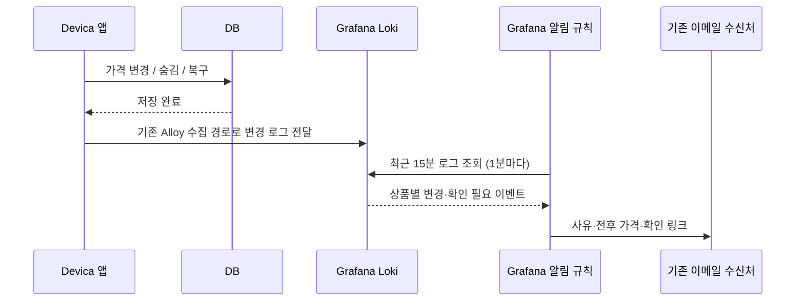

# 쿠팡 가격 최신화 알림 설정

앱은 원인 판정·DB 변경·로그 기록을 담당하고, Grafana는 로그 조건을 평가해 이메일을 보낸다.
이 폴더에는 규칙과 메시지를 준비했다. 실제 Grafana Cloud에는 아직 등록하지 않았다.

화면에서 성공 수치·날짜별 기록·실패 제품을 확인하려면 [Offers 대시보드 설정](DASHBOARD.md)을 먼저 따른다.
대시보드 표시는 이메일 알림 규칙 등록 없이 사용할 수 있다.



## 준비된 알림

| 이름 | 조건 | 알림에 담는 내용 |
|---|---|---|
| 쿠팡 가격 변경 | `price_refresh.price_changed=true` | 제품 코드, 이전·현재 가격, Devica·쿠팡 링크 |
| 쿠팡 판매상품 숨김·복구 | `price_refresh.action=HIDDEN` 또는 `RESTORED` | 제품 코드, 숨김·복구 여부, 확인 링크 |
| 쿠팡 가격 확인 필요 | 검색 결과 없음, ID 추출 불가, 가격 검증 실패, API·DB 실패, 저장 대상 변경 | 제품 코드, 사유, API 오류 코드, 확인 링크 |

`UNCHANGED`와 반복 `ALREADY_HIDDEN`은 변경 알림을 보내지 않는다.
복구하면서 가격도 바뀌면 복구와 가격 변경이 각각 감지된다.
검색 결과에 기존 ID가 없다는 이유로 숨기는 정책이며, 판매 종료를 확정한 알림은 아니다.
저장에 실패하면 변경 이벤트 대신 `DB_FAILURE` 확인 요청을 남긴다.

예시 이메일 내용:

```text
MDH74KH/A 가격 변경
가격: 2080500원 → 2006900원
Devica: https://devica.co.kr/products/1
쿠팡: 기존에 저장한 쿠팡 구매 URL
오퍼 ID: 1
```

숨김 제품의 Devica 상세는 404다. 쿠팡 링크에서 직접 확인할 수 있다.
표시되는 사유는 앱이 관찰한 응답의 상태이며, 쿠팡 검색에서 제외된 내부 이유까지 판별하는 것은 아니다.

## Grafana 화면에서 직접 설정하는 순서

1. 변경된 앱을 dev에 먼저 배포하고 `DEVICA_PUBLIC_BASE_URL=https://2026-devica.vercel.app`을 지정한다.
   prod는 `https://devica.co.kr`이다. 가격 최신화 활성화·실행 시각은 기존 설정을 사용한다.
2. Grafana **Explore → Loki**에서 아래 로그 쿼리로 `price_refresh.result`, `offer.url`, `product.url`이
   도착하는지 확인한다. 로컬 `build/reports/*.log`는 서버 Alloy 수집 대상이 아니므로 여기에 나타나지 않는다.
3. **Alerting → Alert rules → New alert rule**에서 Grafana가 관리하는 규칙을 만든다.
4. [alert-rules.json](alert-rules.json)의 각 `rules[]` 항목을 하나의 규칙으로 등록한다.
   JSON 파일 자체를 일반 대시보드 가져오기에 넣는 방식은 아니다. 아래 항목을 화면에 입력한다.

| Grafana 입력 항목 | 입력할 값 |
|---|---|
| 이름 | 규칙의 `title`. `__ENV__`는 `dev` 또는 `prod`로 변경 |
| Query A 데이터 소스 | 기존 앱 로그가 쌓이는 Loki |
| Query A 쿼리 | 해당 규칙의 `data[0].model.expr`. `__ENV__`를 대상 환경으로 변경 |
| Query A 유형 | Instant(시점 조회). 쿼리 안의 `[15m]`가 감지 범위 |
| 조건 B | A에 대한 Threshold, **IS ABOVE 0** |
| 폴더 | 기존 Devica 폴더 |
| 평가 그룹 | `coupang-price-refresh-dev` 또는 `coupang-price-refresh-prod`, 간격 **1분** |
| Pending period | **0초** |
| No data | **Normal/OK**. 변경이 없는 시간에는 로그가 없는 것이 정상 |
| 쿼리 평가 오류 | **Error**. 로그 조회 실패를 정상으로 처리하지 않음 |
| Labels | 규칙의 `labels` 복사. 환경 값 변경 |
| Summary / Description | 규칙의 `annotations.summary`, `annotations.description` 복사 |
| 알림 수신처 | 기존 이메일 Contact point 선택 또는 그 수신처로 연결된 Notification policy 사용 |

5. **Preview**로 상품 코드와 링크가 포함된 결과를 확인하고 저장한다. 로그가 없을 때는 결과가 비어 있을 수 있다.
   템플릿은 `isPaused=true`로 준비했으므로 API로 등록한 경우에도 확인 후 직접 Resume해야 한다.
6. 기존 이메일 수신처로 전달되는 라우팅을 확인한다. 이 작업 전용 정책을 만들 경우
   `job=coupang-price-refresh`, `env=dev` 또는 `prod`를 조건으로 두고, 그룹은 `alertname`, `env`로 묶는다.
   Group wait 30초, Group interval 5분, Repeat interval 24시간으로 시작할 수 있다.
   상품 ID·링크 라벨은 개별 알림에 유지되어 같은 이메일 안에서 상품별로 확인할 수 있다.
7. 다음 실제 실행에서 로그의 변경 건수와 수신한 알림을 비교한다. 알림 검증을 위해 DB 가격을 임의로 바꾸거나
   실제 API를 반복 호출할 필요는 없다. 실제 변경 이벤트가 없으면 전달까지 검증한 것으로 간주하지 않는다.

화면에서 설정하면 `__FOLDER_UID__`, `__LOKI_UID__`는 폴더·데이터 소스 선택으로 대체된다.
규칙의 링크·가격 필드는 로그에서 읽으므로 제품마다 규칙을 만들 필요는 없다.
Email 알림은 firing/resolved 상태 변경을 전달하는 방식이므로, 수신처의 resolved 알림 설정에 따라
15분 감지 구간이 지난 뒤 해제 알림도 올 수 있다. 상품의 노출 복구는 반드시 `RESTORED` 이벤트로 판단한다.
오래 전 이벤트의 재전송이나 모든 실행의 영구 알림 보장은 없으며, 최종 근거는 실행 로그다.

## 원인을 확인하는 로그 쿼리

```logql
{env="dev", app="devica-app"}
| json
| log_logger="com.wrb.devica.product.infra.coupang.CoupangPriceRefreshJob"
| price_refresh_result!=""
| line_format "{{.product_code}} / {{.price_refresh_result}} / {{.price_refresh_action}} / 오류={{.error_code}} / Devica={{.product_url}} / 쿠팡={{.offer_url}}"
```

원본 로그의 `search.candidate_count`, `search.vendor_item_ids`, `offer.vendor_item_id`를 비교한다.
`IDENTIFIER_UNAVAILABLE`이면 `search.invalid_url_count`, `search.missing_id_count`가 각각 URL 해석 실패와
ID 누락의 수다. 한 후보에서라도 일치 ID와 유효한 가격이 확인되면 다른 후보의 해석 실패만으로 숨기지 않는다.
API 실패는 `error.code`, DB 실패는 `error.type`을 함께 확인한다.
`SKIPPED`는 조회 시작 때와 DB 저장 직전의 연결·상태·가격·날짜 검증이 맞지 않아 저장을 생략한 것이다.

후보 ID·링크는 로그 필드로만 저장한다. 위 쿼리의 `keep`과 `sum by`는 조회 결과를 정리하기 위한 것이며,
Alloy의 Loki 스트림 라벨이나 Prometheus 메트릭 라벨에 제품별 값을 추가하지 않는다.

## 설정 파일의 용도와 검증 범위

`alert-rules.json`은 기존 Grafana Alerting Provisioning HTTP API의 전용 rule group 본문 형식이다.
API로 등록할 때는 `__ENV__`, `__FOLDER_UID__`, `__LOKI_UID__`를 실제 값으로 치환해야 한다.
`PUT /api/v1/provisioning/folder/{folderUid}/rule-groups/{group}`은 해당 그룹을 교체하므로
기존 다른 규칙이 있는 그룹에 덮어쓰지 않는다. 이 API는 공식 문서에서 사용 중단 예정으로 안내하며,
배포된 Grafana에서 지원하지 않으면 위 UI 절차로 등록한다.

코드 테스트는 원인 분류, 숨김·복구, 저장 실패 시 변경 알림 미기록, 가격·링크 필드를 확인한다.
규칙 JSON은 구조와 로그 필드 대응을 확인했다. 실제 Loki 쿼리 평가·이메일 전송은 클라우드 등록 후 확인해야 한다.
이 3개 규칙에는 작업 미실행, 전체 실행 예외, 가격 신선도 알림은 포함하지 않는다.

공식 참고: [Grafana 알림 HTTP API](https://grafana.com/docs/grafana/latest/alerting/set-up/provision-alerting-resources/http-api-provisioning/),
[Loki 로그 쿼리](https://grafana.com/docs/loki/latest/query/log_queries/).
