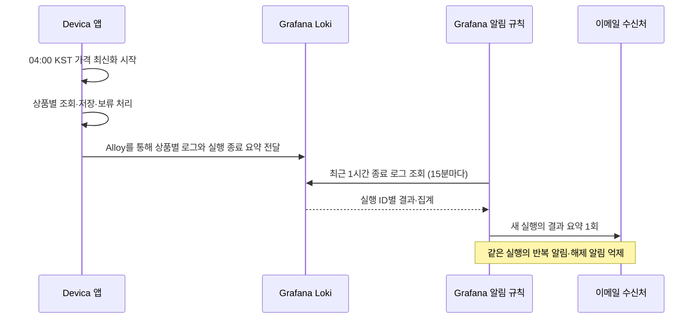

# 쿠팡 가격 최신화 알림 설정

앱은 가격 최신화를 마치면 실행 ID와 결과 집계를 로그에 한 번 남긴다.
Grafana는 **15분마다 최근 1시간의 종료 로그**를 확인하고 **실행별 요약 이메일 1회**를 보내도록 설정한다.
별도 규칙은 **15분마다 최근 26시간의 종료 로그**를 확인하고, 기록이 없으면 누락 알림을 보낸다.
가격 변경·복구·숨김 유지·보류 상품은 개별 이메일 대신 [Offers 대시보드](DASHBOARD.md)에서 확인한다.

알림 규칙은 Grafana Cloud에서 관리한다. 저장소에는 설정 가이드만 둔다.
이 문서를 수정하거나 앱을 배포하는 것만으로 Cloud의 규칙이 변경되지는 않는다.



04시는 기본 시작 시각이다. 알림은 작업 종료 로그가 수집된 뒤 다음 평가에서 감지된다.
정상 수집 시 평가 대기는 최대 약 15분이며, 로그 전달과 이메일 발송 시간은 별도로 걸린다.
하루 한 번 예약 실행하면 요약도 하루 한 번이고, Cloud로 로그를 보내는 서버에서 수동으로 추가 실행하면 실행별로 알림을 보낸다.
Grafana가 실행 ID별 알림 상태를 관리하므로 로그가 조회 범위에 계속 남아 있어도 매 평가마다 이메일을 보내지는 않는다.

## 알림 내용

| 종료 결과 | 의미 | 요약 내용 |
|---|---|---|
| `SUCCESS` | 대상 모두 가격 확인 성공 또는 기존 숨김 유지로 정상 처리 | 전체·가격 확인 성공, 가격 변경·동일·숨김 유지·복구 건수 |
| `PARTIAL` | 정상 처리(가격 확인 성공 또는 숨김 유지)와 보류·미시도가 함께 있음 | 가격 확인 성공 / 전체, 변경·동일·숨김 유지·보류·미시도·복구 건수 |
| `FAILED` | 대상이 있지만 가격 확인 성공·숨김 유지가 모두 0이거나 처리 중 예외 발생 | 집계가 있으면 건수, 집계가 없으면 실행 실패 안내 |
| `NO_TARGETS` | 조회 대상이 없음 | 대상 0개. DB 상태·판매처·기준 ID 확인 |

예시 이메일 본문:

```text
쿠팡 가격 최신화 종료: PARTIAL (dev)
가격 확인 성공: 10 / 20
가격 변경: 8 / 가격 동일: 2
숨김 유지: 4 / 보류: 6 / 미시도: 0 / 기존 숨김 복구: 0
실행 ID: 해당 실행의 run_id
상세: Offers 대시보드 링크
```

가격 확인 성공 수는 `updated + unchanged`이며 복구 건수는 이미 성공에 포함된다. 숨김 유지는 성공 수에 더하지 않는다.
전체 대상은 `success + hiddenUnchanged + deferred + notAttempted`이며, 숨김 유지 건수는 종료 로그의
`price_refresh.hidden_unchanged`로 확인한다. 모두 숨김 유지라면 결과는 `SUCCESS`이고 가격 확인 성공은 `0 / 전체 대상`이다.
가격이 모두 같아도 실행 결과를 알린다. 전후 가격·상품별 사유·구매 링크는 대시보드와 아래 로그 쿼리로 확인한다.
후보가 있고 모든 후보 ID를 읽었지만 기준 ID가 없을 때, 기존 `HIDDEN` 상품은 `HIDDEN_UNCHANGED`로 숨김을 유지한다.
판매 중인 상품은 `NO_MATCH`로 보류한다. 둘 다 `action=NONE`이며 기존 상태·가격·확인 날짜를 유지한다.
빈 검색 결과, ID 해석 실패, 유효하지 않은 가격, API·DB 오류 등은 숨김 상품이어도 기존대로 보류한다.
자동 숨김은 하지 않는다. 기존 숨김 상품은 동일 ID·유효한 가격을 확인했을 때만 복구한다.

## Grafana 화면에서 설정

### 1. 종료 로그 확인

변경된 앱을 dev에 배포하고 가격 최신화를 활성화한다. 서버 실행 설정은
[가격 최신화 가이드의 서버 운영](../../docs/쿠팡_가격_최신화_가이드.md#서버-운영)을 따른다.
Grafana **Explore → Loki**에서 다음 쿼리로 실행 ID와 종료 결과가 도착하는지 확인한다.
예시는 dev 기준이며 prod에서는 모든 쿼리·규칙 이름·정책의 환경 값을 함께 바꾼다.

```logql
{env="dev", app="devica-app"}
| json
| log_logger="com.wrb.devica.product.infra.coupang.CoupangPriceRefreshJob"
| price_refresh_seller="COUPANG"
| price_refresh_outcome=~"SUCCESS|PARTIAL|FAILED|NO_TARGETS"
```

일일 작업이므로 Explore 시간 범위는 우선 **Last 2 days**로 둔다.
로컬 `build/reports/*.log`는 서버 Alloy 수집 대상이 아니므로 Cloud에 자동으로 나타나지 않는다.

### 2. 실행 요약 규칙 한 개 등록

**Alerting → Alert rules → New alert rule**에서 Grafana가 관리하는 규칙을 만든다.

| 입력 항목 | 입력할 값 |
|---|---|
| 이름 | `쿠팡 가격 최신화 실행 요약 (dev)` 또는 `(prod)` |
| Query A 데이터 소스 | 기존 앱 로그가 쌓이는 Loki |
| Query A 유형 | **Instant**. 아래 쿼리의 `[1h]`가 조회 범위 |
| 조건 B | A에 대한 **Threshold**, **IS ABOVE 0**, 알림 조건으로 지정 |
| 폴더 | 기존 Devica 폴더 |
| 평가 그룹 | 이 규칙 전용 `coupang-price-refresh-summary-dev` 또는 `-prod`, 간격 **15분** |
| Pending period / Keep firing for | 모두 **0초** |
| No data | **Normal/OK**. 종료 로그가 없는 대부분의 시간은 정상 |
| 쿼리 평가 오류 | **Error**. 로그 조회 장애를 정상으로 처리하지 않음 |
| Labels | `service=devica`, `job=coupang-price-refresh`, `notification=run-summary`, `env=dev` 또는 `prod`, `severity=info` |
| 알림 라우팅 | 아래 전용 **Notification policy** 사용 |

다른 알림과 평가 그룹을 공유하지 않는다. **Classic condition**은 조회 라벨을 제거하므로 사용하지 않는다.
`run_id`를 고정된 규칙 Label로 입력하지 않고 아래 쿼리의 `price_refresh_run_id`를 유지한다.

Query A:

```logql
sum by (env, price_refresh_seller, price_refresh_run_id, price_refresh_outcome, price_refresh_success, price_refresh_total, price_refresh_updated, price_refresh_unchanged, price_refresh_hidden_unchanged, price_refresh_deferred, price_refresh_not_attempted, price_refresh_restored) (
  count_over_time(
    {env="dev", app="devica-app"}
    | json
    | log_logger="com.wrb.devica.product.infra.coupang.CoupangPriceRefreshJob"
    | price_refresh_seller="COUPANG"
    | price_refresh_run_id!=""
    | price_refresh_outcome=~"SUCCESS|PARTIAL|FAILED|NO_TARGETS"
    | __error__=""
    | keep env, price_refresh_seller, price_refresh_run_id, price_refresh_outcome, price_refresh_success, price_refresh_total, price_refresh_updated, price_refresh_unchanged, price_refresh_hidden_unchanged, price_refresh_deferred, price_refresh_not_attempted, price_refresh_restored
    [1h]
  )
)
```

`A > 0`은 종료 로그가 있다는 뜻이다. 가격 확인 성공률을 조건으로 삼지 않으므로 실패·대상 없음도 알려 준다.
같은 결과·건수라도 다음 실행의 `run_id`는 달라 새로운 알림으로 감지한다.
`keep`과 `sum by`는 조회 결과를 정리할 뿐, Alloy의 Loki 스트림 라벨이나 Prometheus 메트릭에 실행 ID를 추가하지 않는다.

Summary:

```text
쿠팡 가격 최신화 종료: {{ $labels.price_refresh_outcome }} ({{ $labels.env }})
```

Description:

```text
{{ if $labels.price_refresh_total }}가격 확인 성공: {{ $labels.price_refresh_success }} / {{ $labels.price_refresh_total }}
가격 변경: {{ $labels.price_refresh_updated }} / 가격 동일: {{ $labels.price_refresh_unchanged }}
숨김 유지: {{ if $labels.price_refresh_hidden_unchanged }}{{ $labels.price_refresh_hidden_unchanged }}{{ else }}기록 없음{{ end }} / 보류: {{ $labels.price_refresh_deferred }} / 미시도: {{ $labels.price_refresh_not_attempted }} / 기존 숨김 복구: {{ $labels.price_refresh_restored }}
{{ else }}실행 중 예외로 최종 집계가 없습니다. 같은 실행 ID의 오류 로그를 확인하세요.
{{ end }}실행 ID: {{ $labels.price_refresh_run_id }}
상세: <Offers 대시보드 URL>
```

`<Offers 대시보드 URL>`은 Cloud에서 실제 대시보드 링크를 복사해 바꾼다.
대시보드의 환경·판매처를 선택하고 시간 범위를 해당 실행을 포함하도록 지정한다. 개별 상품 링크는 로그에 남아 있다.
Summary와 Description은 **알림 규칙의 annotation**에 입력한다. Contact point의 Message와는 템플릿 변수가 다르다.
이전 로그에 `price_refresh.hidden_unchanged`가 없으면 숨김 유지 수를 `기록 없음`으로 표시한다. 과거 건수를 0으로 추정하지 않는다.

### 3. 같은 실행의 반복·해제 이메일 방지

기존 수신자 주소를 사용하는 **요약 전용 Email Contact point**를 만들고
**Disable resolved message**를 켠다. 공용 Contact point를 수정해 다른 장애 알림의 복구 통지까지 끄지 않는다.
요약 규칙의 감지 범위가 지난 것은 상품 복구가 아니므로 해제 이메일을 보내지 않는다.

Notification policy에 아래 전용 경로를 추가한다.

| 항목 | 값 |
|---|---|
| 일치 조건 | `job=coupang-price-refresh`, `notification=run-summary`, `env=dev` 또는 `prod` |
| Contact point | 위 요약 전용 Email 수신처 |
| Group by | `grafana_folder`, `alertname`, `env`, `price_refresh_run_id` |
| Group wait | **30초** |
| Group interval | **5분** |
| Repeat interval | **24시간** |
| Continue matching subsequent sibling nodes | **끔**. 동일 요약의 중복 라우팅 방지 |

실행 ID별로 다른 알림 그룹을 만들고, 조회 범위 1시간보다 긴 재알림 간격을 사용한다.
정상 평가가 이어지면 같은 실행은 다음 재알림 전에 해제되므로 첫 요약만 전달된다.
이는 정상 수집·평가 중 실행당 1회를 목표로 하는 설정이며, 장애·규칙 재생성 등을 포함한 정확히 한 번의 전달 보장은 아니다.
로그 조회 오류 알림은 실행 요약과 별개로 발생할 수 있다.

### 4. 기존 규칙 교체와 확인

기존 상품별 **가격 변경 / 판매상품 복구 / 가격 확인 필요** 규칙을 등록했다면 요약 규칙으로 교체하고
이전 규칙은 중지한다. 두 방식을 함께 켜면 요약과 상품별 이메일이 모두 온다.

1. Query A와 조건 B의 **Preview**에서 실행별 한 결과와 `price_refresh_run_id`, 집계 라벨을 확인한다.
   최근 1시간에 종료 로그가 없으면 비어 있는 것이 정상이다. 이전 로그는 Explore에서 확인한다.
2. Contact point의 **Test**로 수신처 전달을 확인한다. 테스트 메일은 실제 종료 로그 감지까지 검증하지 않는다.
3. 다음 실제 실행 후 종료 로그와 이메일의 가격 확인 성공·숨김 유지·전체·보류 수를 비교한다.
4. 같은 실행이 다음 15분 평가에도 잡혀도 재전송되지 않고, 조회 범위에서 빠진 뒤 해제 이메일도 없는지 확인한다.
5. 다음 날 건수가 같더라도 새 `run_id`의 요약은 도착하는지 확인한다.

실제 API를 반복 호출하거나 DB 가격을 임의로 변경해서 알림을 만들 필요는 없다.
Cloud에서 쿼리 평가와 이메일 전달을 확인하기 전에는 알림 검증 완료로 간주하지 않는다.

## 종료 로그 누락 알림 설정

실행 요약 규칙과 함께 사용한다. **자동 가격 최신화를 활성화한 환경**에서 최근 26시간 동안 종료 로그가
없으면 알린다. 기본 시각인 04:00 KST에 작업이 끝난 기록이 없다면 이전 종료 시각으로부터
26시간이 지난 뒤 다음 평가(15분 이내)에 감지된다. 환경별 예약 시각을 바꿔도 기준은 마지막 종료 시각이다.

### 1. 조회 조건 확인

기존 [종료 로그 확인 쿼리](#1-종료-로그-확인)를 Explore에서 실행해 해당 환경의 실제 종료 로그와
`price_refresh_outcome`을 확인한다. `FAILED`도 종료 기록이다. 실패 원인은 실행 요약 이메일과 같은
`run_id`의 로그에서 확인한다. 시작 로그나 상품별 로그만 있으면 작업을 완료한 것으로 보지 않는다.

### 2. 누락 규칙 등록

**Alerting → Alert rules → New alert rule**에서 요약 규칙과 별개로 등록한다.
아래는 dev 예시다. prod에 적용할 때는 쿼리의 `env="dev"`, 이름·Labels·라우팅 조건·Summary의 환경 표시를 `prod`로 바꾼다.

| 입력 항목 | 입력할 값 |
|---|---|
| 이름 | `쿠팡 가격 최신화 종료 로그 누락 (dev)` 또는 `(prod)` |
| Query A 데이터 소스 / 유형 | 기존 앱 로그가 쌓이는 Loki / **Instant** |
| Query A 쿼리 | 아래 LogQL. `[26h]`가 종료 로그 조회 범위 |
| 조건 B | A에 대한 **Threshold**, **IS ABOVE 0**, 알림 조건으로 지정 |
| 폴더 | 기존 Devica 폴더 |
| 평가 그룹 | 이 규칙 전용 `coupang-price-refresh-missing-dev` 또는 `-prod`, 간격 **15분** |
| Pending period / Keep firing for | 모두 **0초** |
| No data | **Normal/OK**. 종료 로그가 있으면 쿼리가 빈 결과를 반환하므로 정상으로 처리 |
| 쿼리 평가 오류 | **Error**. Loki 조회 오류는 정상 실행으로 취급하지 않음 |
| Labels | `service=devica`, `job=coupang-price-refresh`, `notification=run-missing`, `env=dev` 또는 `prod`, `severity=warning` |
| 알림 라우팅 | 아래 누락 전용 **Notification policy** 사용 |

Query A:

```logql
absent_over_time(
  {env="dev", app="devica-app"}
  | json
  | log_logger="com.wrb.devica.product.infra.coupang.CoupangPriceRefreshJob"
  | price_refresh_seller="COUPANG"
  | price_refresh_outcome=~"SUCCESS|PARTIAL|FAILED|NO_TARGETS"
  | __error__=""
  [26h]
)
```

최근 26시간에 종료 로그가 있으면 결과가 비어 **Normal**, 없으면 값 `1`이 반환되어 **Alerting**이다.
`No data=Alerting`만으로 구성하면 정상적으로 종료 로그가 있을 때 오히려 알림이 날 수 있으므로
위 쿼리와 `No data=Normal/OK`를 함께 사용한다.

Summary:

```text
쿠팡 가격 최신화 종료 로그 누락 (dev)
```

Description:

```text
최근 26시간 동안 쿠팡 가격 최신화 종료 로그가 없습니다.
예약 작업 활성화·실행, 앱 상태, Alloy 로그 전달, Loki 조회 상태를 확인하세요.
상세: <Offers 대시보드 URL>
```

`<Offers 대시보드 URL>`을 실제 Cloud 대시보드 링크로 바꾼다. 위 문구는 **알림 규칙의 annotation**에 입력한다.
이 규칙은 원인을 판정하지 않는다. 앱 미기동·실행 중단·작업 지연·로그 전달 누락 모두 가능하다.
이미 종료 로그가 도착한 `FAILED`는 누락이 아니라 실행 요약 규칙에서 알린다.

### 3. 수신처와 활성화

**요약 전용 Email Contact point는 해제 알림을 꺼 두었으므로 사용하지 않는다.**
누락 규칙에는 기존 이메일 주소로 별도 Contact point를 만들고 **Disable resolved message를 끈다**.
이후 종료 로그가 도착해 정상으로 돌아오면 해제 이메일도 받을 수 있다.

Notification policy에 누락 규칙 전용 경로를 추가한다.

| 항목 | 값 |
|---|---|
| 일치 조건 | `job=coupang-price-refresh`, `notification=run-missing`, `env=dev` 또는 `prod` |
| Contact point | 위 누락 알림용 Email 수신처 |
| Group by | `grafana_folder`, `alertname`, `env` |
| Group wait / Group interval | **30초 / 5분** |
| Repeat interval | **24시간**. 종료 로그가 계속 없으면 하루 뒤 재알림 |
| Continue matching subsequent sibling nodes | **끔**. 중복 라우팅 방지 |

자동 갱신을 켠 환경에만 이 규칙을 활성화한다. 최초 활성화 시에는 앱의 첫 종료 로그가 Loki에
도착한 것을 [Explore 쿼리](#1-종료-로그-확인)로 확인한 뒤 규칙을 켠다. 그 전에 켜면 과거 26시간에
종료 로그가 없어 즉시 알림이 올 수 있다. 의도적으로 작업을 끈 환경이나 일일 실행을 중지한
환경에서는 누락 규칙도 중지한다.

### 4. 확인

1. 정상 실행의 종료 로그가 최근 26시간에 있으면 Query A의 **Instant Preview**가 빈 결과이며
   알림 상태는 **Normal**인지 확인한다. 비어 있는데 No Data 상태가 되면 위 설정을 확인한다.
2. 종료 로그가 26시간 넘게 없는 환경에서 값 `1`, 조건 B의 Alerting, 이메일 전달을 확인한다.
   정상 운영 환경에서 이 검증을 위해 쿠팡 API를 재호출하거나 종료 로그를 지우지 않는다.
3. 다음 실제 실행의 종료 로그가 도착하면 누락 알림이 해제되는지 확인한다. 종료 로그가 없다면
   앱과 Alloy·Loki 상태를 함께 확인한다.

26시간 기준은 **마지막 종료 로그**를 본다. 같은 환경에서 수동 실행으로 종료 로그가 남아도 시계가
다시 시작되며, 04시 예약 작업의 실행 여부만 별도로 판정하지 않는다. Cloud에서 쿼리와 이메일
수신을 확인하기 전에는 실제 누락 알림 동작을 검증한 것으로 보지 않는다.
Loki의 해당 환경 로그 보관 기간도 26시간 이상이어야 한다. 보관 기간이 더 짧으면 정상 실행 로그가
먼저 사라져 누락 알림이 날 수 있다.

## 상품별 원인 확인

이메일의 실행 ID를 아래 `실행_ID`에 넣고 Explore 시간 범위를 해당 날짜로 맞춘다.
이 쿼리는 해당 실행의 시작·상품별 결과·종료·예외를 함께 보여 준다.

```logql
{env="dev", app="devica-app"}
| json
| log_logger="com.wrb.devica.product.infra.coupang.CoupangPriceRefreshJob"
| price_refresh_run_id="실행_ID"
```

보류·미시도 상품만 보려면 마지막에 다음 필터를 추가한다. 로그를 펼치면 제품 코드와 링크를 볼 수 있다.

```logql
| price_refresh_result=~"NO_MATCH|NO_SEARCH_RESULTS|IDENTIFIER_UNAVAILABLE|INVALID_PRICE|CONFLICTING_PRICES|API_FAILURE|DB_FAILURE|SKIPPED|NOT_ATTEMPTED"
```

`HIDDEN_UNCHANGED`는 정상적인 숨김 유지이므로 이 보류 필터에서 제외한다. 숨김 유지 상품은
`| price_refresh_result="HIDDEN_UNCHANGED"`로 별도 확인한다.

- `offer.url`: 쿠팡 구매 링크. 숨김 상품의 Devica 상세는 404이므로 이 링크에서 확인한다.
- `product.url`: Devica 제품 링크.
- `search.candidate_count`, `search.vendor_item_ids`, `offer.vendor_item_id`: 검색 후보와 기준 ID 비교.
- `search.invalid_url_count`, `search.missing_id_count`: URL 해석 실패·ID 누락 수.
- API 실패는 `error.code`, DB 실패는 `error.type`으로 구분한다.
- `CannotCreateTransactionException`이면 현재 상품은 `DB_FAILURE`, 남은 상품은 `NOT_ATTEMPTED`다.
  작업은 중단하지만 앞선 가격 확인 성공·숨김 유지·현재 보류·남은 미시도 건수는 종료 요약에 포함한다.
- `SKIPPED`는 조회 시작과 저장 직전의 연결·상태·가격·날짜가 맞지 않아 저장을 생략한 것이다.

같은 ID와 유효한 가격을 찾았다면 다른 후보의 해석 실패만으로 보류하지 않는다.
상품별 가격 변경·복구·숨김 유지·확인 필요 기록은 기존 대시보드에도 계속 남는다.

## 확인 범위와 한계

앱은 기존 종료 집계를 사용한다. 새 스케줄러·메일 전송 코드·테이블은 추가하지 않는다.
쿼리·템플릿의 필드는 앱 로그와 맞춰 작성했으며 실제 Loki 평가·이메일 전달은 Cloud에서 확인한다.
실제 조건·수신처·활성화 여부는 Cloud에서 관리한다. 이 가이드는 설정 백업이 아니다.

종료 로그의 `FAILED`는 요약에 포함한다. 종료 로그 자체가 없는 경우는 별도 누락 규칙이 감지한다.
가격 신선도 알림은 별도 정책이다. 1시간을 넘긴 수집 장애로 요약 규칙의 조회 범위를 벗어난 로그는 놓칠 수 있다.
최종 실행 근거는 앱 로그와 DB 확인 날짜이며, 요약 이메일은 이를 확인하는 통로다.

공식 참고: [알림 평가](https://grafana.com/docs/grafana/latest/alerting/fundamentals/alert-rule-evaluation/),
[그룹과 반복 간격](https://grafana.com/docs/grafana/latest/alerting/fundamentals/notifications/group-alert-notifications/),
[이메일·해제 알림](https://grafana.com/docs/grafana/latest/alerting/configure-notifications/manage-contact-points/integrations/configure-email/),
[규칙 템플릿](https://grafana.com/docs/grafana/latest/alerting/alerting-rules/templates/reference/),
[Loki 로그 쿼리](https://grafana.com/docs/loki/latest/query/log_queries/),
[Loki 범위 집계 쿼리](https://grafana.com/docs/loki/latest/query/metric_queries/),
[Loki 알림의 No Data 처리](https://grafana.com/docs/grafana/latest/datasources/loki/alerting/).
