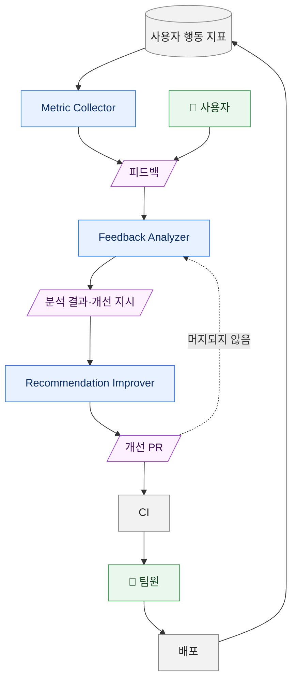

# 제품 추천 개선

**사용자 피드백과 행동 지표를 바탕으로 제품 추천을 개선하는 시스템이다.** 피드백 분석부터 제품 추천 정의서(이하 정의서)를 고친 PR 작성까지 자동으로 하고, 팀원은 그 PR 을 검토해 승인한다.

정의서는 제품 추천의 질문과 규칙을 담은 YAML 파일로, 사용 목적마다 하나씩 `src/main/resources/recommendation/purposes/` 에 있다.

## 시스템 구조



- 초록: 시스템 밖의 사람
- 파랑: 시스템 구성 요소
- 보라: 구성 요소 사이의 산출물
- 회색: 기존 저장소 및 단계
- 점선: 개선 PR 이 머지되지 않았을 때만 생기는 경로

### Metric Collector

> 사용자 지표로 개선 가설을 세워 피드백을 만든다

- 사용자 행동 지표에서 제품 추천 결과가 맞지 않았다는 신호를 찾는다.
- 사용자가 바꾼 답과, 그 때문에 어느 항목이 과하거나 부족했다고 추정되는지를 담아 피드백을 만든다.
- 규칙을 고치면, 그 규칙이 적용되는 사용자의 지표는 고친 규칙이 배포된 뒤부터 다시 수집한다.
- 배포된 개선도 다시 지표에 쌓이므로, 개선이 지나쳤다면 반대 방향의 가설로 이어진다.

하지 않는 것:

- 근거가 기준에 못 미치거나, 같은 신호의 피드백이 열려 있으면 만들지 않는다. 열린 피드백의 신호가 기준 아래로 줄면 닫는다.
- 개인을 식별할 수 있는 정보는 남기지 않는다.

### Feedback Analyzer

> 피드백을 분석해 개선 지시를 내린다

- 피드백을 재현해 원인을 찾고, 판단을 정한다: 
  - 개선 지시 / 보류 / 팀원이 직접 처리 / 이미 바뀜 / 재현할 수 없음
- 근거에 지표 추정이 들어간 개선 지시는 별도로 표시한다.
- 머지되지 않은 개선은 반려 사유와 함께 다시 판단한다. 반려되면 같은 근거로 다른 규칙을 찾지 않는다.

하지 않는 것:

- 정의서를 고치지 않는다.
- 같은 항목에 처리 중인 개선 지시가 있으면 새로 내지 않는다.

### Recommendation Improver

> 개선 지시대로 정의서를 개선하고 PR 을 올린다

- 개선 지시대로 정의서를 개선하고, 결과가 지시의 기대와 같은지 검증한 뒤 PR 을 올린다.
- PR 을 올리지 못하면 그 결과를 남겨 Feedback Analyzer 가 다시 판단하게 한다.

하지 않는 것:

- 피드백 원문을 읽지 않는다.
- 지시 밖은 고치지 않는다.
- 기대와 다르면 PR 을 올리지 않는다.

### 팀원

> PR 을 승인하고, 정의서로 고칠 수 없는 피드백을 처리한다

- 개선 PR 을 검토해 승인한다.
- Feedback Analyzer 가 정의서로 고칠 수 없다고 표시한 피드백(질문 변경, 코드 변경, 제품 추천과 무관한 제보)과 개선 PR 이 반려된 피드백을 직접 처리하거나 닫는다.
- 판단이 "이미 바뀜"이나 "재현할 수 없음"인 피드백을 확인해 닫는다.

## 원칙

- 구성 요소는 서로를 직접 부르지 않고 피드백, 분석 결과·개선 지시, 개선 PR, 개선 결과로만 이어진다. 그래서 각 구성 요소의 구현을 따로 바꿀 수 있다.
- 사용자가 직접 쓴 피드백은 Feedback Analyzer 만 읽는다. Recommendation Improver 는 팀원이 쓴 지시만 따른다.
- 개선 지시는 피드백이 짚은 원인이 정의서의 전제와 어긋나거나, 같은 규칙을 같은 방향으로 가리키는 피드백이 여럿이거나, 지표 피드백의 바꾼 답이 특정 규칙을 가리키거나, 추천 결과를 직접 고친 세션이 2건 이상이고 고친 값이 특정 규칙을 가리킬 때만 낸다.
- 개선은 결과 변화를 추적할 수 있는 최소 단위(규칙 하나)로 하고, 열린 개선 PR 은 한 번에 하나만 둔다.
- 개선 PR 이 승인·머지되면 근거가 된 피드백을 닫는다. 머지되지 않으면 그 사유와 함께 Feedback Analyzer 가 다시 판단한다.
- 지표 추정에 기댄 개선은 개선 지시와 개선 PR 에 표시한다. 검토할 때 사용자가 직접 말한 것과 구분하기 위해서다.

## 디렉터리 구성

```
recommendation-improvement/
  interface/                 인터페이스. 구현과 무관하다
    artifacts/               산출물의 형식
    components/              구성 요소의 명세
    binding.md               산출물과 저장 위치의 바인딩
  metric-collector/          구현. 지금은 에이전트가 예약 실행으로 따르는 지시문(prompt.md)과 스크립트
  feedback-analyzer/
  recommendation-improver/
  common.py                  세 구현이 함께 쓰는 스크립트
```

구현은 `interface/` 에 의존하고 `interface/` 는 구현을 모른다.
## 사용 방법

### 피드백 현황 보기

피드백은 `product-recommendation-feedback` 라벨이 붙은 이슈다. 종류는 제목 머리말로 구분한다.

| 머리말          | 종류                             |
|--------------|--------------------------------|
| `[제품 추천 의견]` | 사용자가 남긴 피드백                    |
| `[제품 추천 지표]` | Metric Collector 가 지표에서 찾은 피드백 |

각 피드백의 상태는 Feedback Analyzer 가 남긴 분석 결과의 판단에 드러난다.

| 판단        | 뜻                        | 팀원이 할 일     |
|-----------|--------------------------|-------------|
| 개선 지시     | 개선 PR 이 올라온다             | PR 을 검토한다   |
| 보류        | 근거가 더 모이기를 기다린다          | 없다          |
| 팀원이 직접 처리 | 정의서로 고칠 수 없거나, 개선이 반려됐다  | 직접 고치거나 닫는다 |
| 이미 바뀜     | 사용자가 본 뒤 다른 개선으로 이미 고쳐졌다 | 확인하고 닫는다    |
| 재현할 수 없음  | 질문이 바뀌어 같은 결과를 볼 수 없다    | 확인하고 닫는다    |

처리를 멈추고 싶은 피드백은 이슈를 닫는다. 닫힌 이슈의 개선 지시는 Recommendation Improver 가 처리하지 않고, Feedback Analyzer 도 다시 보지 않는다.

### 개선 PR 검토하기

개선 PR 마다 아래를 확인한다.

- 바꾼 규칙이 하나뿐인가.
- 재현 사례의 결과 변화가 피드백이 지적한 방향과 맞는가.
- 영향 범위(바뀐 사례 수, 대표 사용자 중 바뀐 것)가 근거 피드백으로 바꿔도 될 만큼인가. 답별로 나눈 수에 피드백과 상관없는 사용자가 섞여 있지 않은가.
- 같은 규칙을 최근에 반대로 바꾼 적이 있으면, 고쳤다 되돌리는 것이 아닌가.
- 지표 추정 표시가 있으면, 추정한 항목과 방향이 그럴듯한가.

승인해 머지하면 근거 피드백이 닫힌다. 반려할 때는 **사유를 PR 에 남기고 닫는다.** Feedback Analyzer 가 그 사유를 근거에 더해 다시 판단한다. 사유 없이 닫으면 같은 판단을 다시 할 수 있다. 다른 규칙이 원인이라고 보면 사유에 그 규칙을 적는다. 적지 않으면 그 근거 피드백은 "팀원이 직접 처리"로 넘어온다.

### 팀원이 직접 처리할 피드백

판단이 "팀원이 직접 처리"인 이슈는 분석 결과에 무엇을 왜 사람이 고쳐야 하는지 적혀 있다. 질문 변경, 코드 변경, 제품 추천과 무관한 제보, 개선 PR 이 반려된 피드백이 여기에 해당한다. 고치거나 더 할 일이 없으면 이슈를 닫는다.

### 기준값 고치기

지표 피드백이 너무 자주 나오거나 안 나오면 [기준값](interface/components/metric-collector.md#기준값)의 신호 최소 건수를 조정한다. 처음 값 2 는 5주간 결과 조회 128건, 답을 바꿔 다시 본 세션 7건이던 때 정한 것이다.

## 실행

- 세 구성 요소는 서로 독립적으로 실행된다. 실행 순서와 주기는 맞추지 않아도 된다. 각 구성 요소는 실행될 때 그때까지 쌓인 산출물을 처리한다.
- 각 구성 요소는 한 번에 하나만 실행된다. 겹쳐 실행되면 같은 산출물을 두 번 남긴다.
- Recommendation Improver 는 사용자의 작업과 분리된 작업 공간에서 실행된다.
- 구성 요소마다 필요한 권한과 환경은 [`interface/components/`](interface/components/)의 "의존하는 외부 시스템"에 있다.

지금은 에이전트가 정해진 주기마다 지시문을 따라 실행된다. 구성 요소마다 지시문(`<구성 요소>/prompt.md`)과 스크립트(`signals.py`·`snapshot.py`, 공통 `common.py`)가 있고, 실행될 때마다 `origin/develop` 에서 새로 읽어 온다. 리뷰를 거쳐 머지된 내용만 실행되고, 지시문이 바뀌어도 작업을 다시 등록하지 않아도 된다. 구현을 바꾸면 이 절과 구성 요소 디렉터리를 새 구현의 것으로 바꾸고, 이전 작업은 끈다.

### 1. 준비하기

실행 방식과 상관없이 필요하다. 하나라도 빠지면 작업이 중간에 멈춘다.

1. **GitHub CLI**: 레포 멤버 계정으로 로그인하고, 아래 두 번째 줄이 `true` 를 출력하는지 본다.
   ```bash
   gh auth status
   gh api repos/woowacourse-teams/2026-Devica --jq .permissions.push
   ```
2. **`python3`, `ruby`**: `python3 --version` 이 실패하면 `xcode-select --install` 을 실행한다.
3. **레포 clone**: 이 레포의 clone 하나를 작업 폴더로 정한다. 평소 쓰는 clone 이어도 된다.
4. **Feedback Analyzer**: 아래 두 줄이 모두 `200` 을 출력하는지 본다.
   ```bash
   curl -s -o /dev/null -w '%{http_code}\n' http://dev.devica.co.kr/api/usage-purposes/BACKEND_DEVELOPMENT/recommendation
   curl -s -o /dev/null -w '%{http_code}\n' https://api.devica.co.kr/api/usage-purposes/BACKEND_DEVELOPMENT/recommendation
   ```
5. **Recommendation Improver**: JDK 와 Docker Desktop 을 설치하고([백엔드 개발 환경 가이드](../docs/백엔드_개발_환경_가이드.md)), 작업이 실행되는 동안 Docker Desktop 을 켜 둔다.

### 2. 예약 작업 등록하기

팀원 한 명만 등록한다. 여러 명이 등록하면 같은 작업이 겹쳐 실행된다. Mac 이면 [Mac 에 등록하기](#mac-에-등록하기), 아니면 [다른 방법으로 등록하기](#다른-방법으로-등록하기)를 따른다.

#### Mac 에 등록하기

1. **에이전트 확인**: 아래가 버전을 출력하는지 본다. 실패하면 Claude Code 를 설치하고 개인 구독 계정으로 로그인한다.
   ```bash
   claude --version
   ```
2. **PostHog 연결**: claude.ai 의 설정 → 커넥터에서 PostHog 를 팀 PostHog 계정으로 연결한다. 그 뒤 `claude` 를 열고 아래 두 줄을 차례로 보낸다. 두 번째 답에 `638813` 이 나오면 된다.
   ```
   PostHog 활성 프로젝트를 638813 으로 바꿔줘
   PostHog 활성 프로젝트 확인해줘
   ```
3. **등록**: 작업 폴더에서 아래를 실행한다. `등록: <구성 요소>` 가 세 줄 나오면 된다.
   ```bash
   recommendation-improvement/schedule/install.sh
   ```
4. **켜 두기**: 작업이 실행되는 동안 Mac 을 켜 두고 로그인해 둔다. `metric-collector` 는 매일 09:00, `feedback-analyzer` 는 매일 10:00, `recommendation-improver` 는 4시간마다 실행된다.

#### 다른 방법으로 등록하기

1. **PostHog 연결**: 에이전트에 PostHog MCP 를 팀 PostHog 계정으로 연결하고, [Mac 에 등록하기](#mac-에-등록하기)의 2 처럼 활성 프로젝트를 `638813` 으로 맞춘다.
2. **작업 만들기**: 아래 표의 구성 요소마다 예약 작업을 하나씩 만든다. 작업 폴더는 1-3 의 clone, 주기는 표대로 정한다.
3. **프롬프트**: `<구성 요소>` 를 바꿔 넣는다.
   ```
   작업 폴더의 git 레포에서 `git fetch -q origin` 을 실행한 뒤,
   `git show origin/develop:recommendation-improvement/<구성 요소>/prompt.md` 의 출력을
   이번 실행의 지시문으로 삼아 끝까지 따른다. 지시문의 SELF_REF 는 origin/develop 이다.
   ```
4. **권한**: 표의 권한을 실행 중에 묻지 않도록 미리 허용한다.

| `<구성 요소>` | 주기 | 허용할 권한 |
|---|---|---|
| `metric-collector` | 하루 한 번 | Bash `git` `gh` `python3` `ruby`. `~/.devica-product-recommendation/metric-collector` 쓰기. PostHog `project-get`, `execute-sql` |
| `feedback-analyzer` | 하루 한 번, `metric-collector` 보다 늦은 시각 | Bash `git` `gh` `python3` `ruby`. `~/.devica-product-recommendation/feedback-analyzer` 쓰기 |
| `recommendation-improver` | 몇 시간마다 | Bash `git` `gh` `python3` `ruby` `docker` `./gradlew`. `~/.devica-product-recommendation/recommendation-improver` 쓰기와 그 안의 작업 공간 파일 편집 |

### 3. 첫 실행 확인하기

작업 폴더에서 구성 요소마다 한 번 바로 실행하고, 끝나면 가장 최근 실행 기록을 연다.

```bash
recommendation-improvement/schedule/run.sh <구성 요소>
ls -t ~/.devica-product-recommendation/<구성 요소>/runs | head -1
```

기록에 오류가 있으면 아래 문제 해결을 본다. 이슈·댓글·PR 없이 기록만 남아도 정상이다.
피드백 이슈에 분석 결과 댓글이 달리면 [피드백 현황 보기](#피드백-현황-보기)대로 처리한다.

### 문제 해결

| 이럴 때 | 이렇게 한다 |
|---|---|
| 기록에 "PostHog 커넥터가 프로젝트 … 를 가리켜 멈춘다"가 있다 | 커넥터의 활성 프로젝트를 `638813` 으로 바꾼다 |
| 기록에 `fetch` 실패가 있다 | `gh auth status` 로 로그인 상태를 다시 본다 |
| 기록에 API 호출 실패가 있다 | 개발·운영 서버가 떠 있는지, 지금 네트워크에서 접속되는지 본다 |
| 기록에 테스트 DB 연결 실패가 있다 | Docker Desktop 을 켠다 |
| 기록에 push 실패가 있다 | 로그인한 계정으로 `git push` 가 되는지 본다 |
| 기록도 남기지 않고 바로 끝난다 | 앞 실행이 도중에 끊겨 잠금 디렉터리가 남은 것이다. `rm -rf ~/.devica-product-recommendation/<구성 요소>/lock` 으로 지운다. 그냥 두어도 6시간 뒤 다음 실행이 지운다 |

### 설정값

GitHub 레포, API 주소, PostHog 프로젝트, 상태 디렉터리, 개선 브랜치 이름은 각 `prompt.md` 의 설정 표에 있다. 조회 기간과 신호 최소 건수는 [기준값](interface/components/metric-collector.md#기준값)에 있다. 고쳐서 머지하면 다음 실행부터 바뀐 값으로 실행된다.

### 머지 전에 시험하기

프롬프트의 `origin/develop` 두 곳을 시험할 원격 브랜치(`origin/<브랜치>`)로 바꿔 작업을 하나 더 만든다. 시험 중에도 실제 이슈에 댓글이 달리고 PR 이 올라가므로, 시험용 피드백·개선 지시만 있을 때 돌린다. 시험이 끝나면 그 작업은 지운다.

### 멈추기

등록한 방식에서 작업을 끄거나 지운다. Mac 의 launchd 로 등록했다면 `recommendation-improvement/schedule/install.sh uninstall` 을 실행한다. Recommendation Improver 를 더 쓰지 않을 거면 작업 공간도 지운다.

```bash
git worktree remove --force ~/.devica-product-recommendation/recommendation-improver/worktree
```

실행 기록은 `~/.devica-product-recommendation/<구성 요소>/runs/` 에 그대로 남는다.
